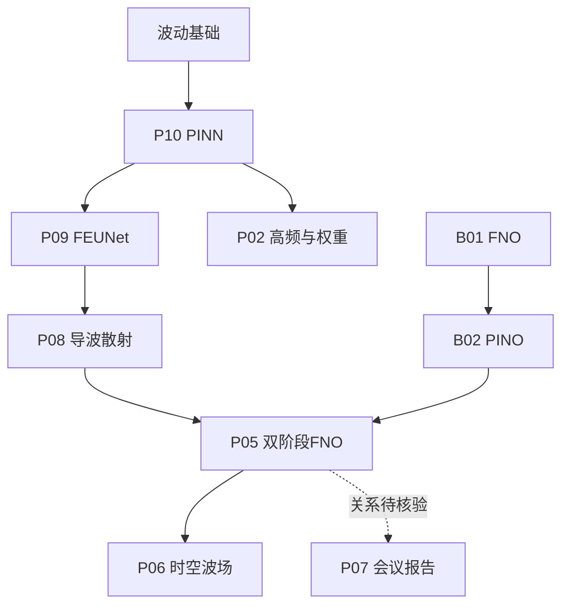
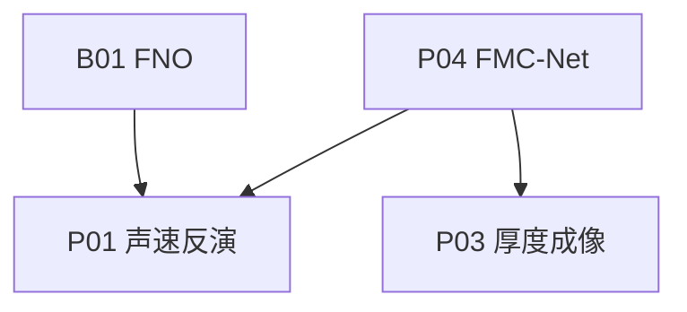

# 文献地图

## 当前跨领域研究入口

[[相控阵FWI与神经算子跨领域进展 2026-10-07]] 将相控阵、医学超声、地震和学习型求解器按网络在反演中的位置关联。20 项来源及版本状态见 [[相控阵FWI跨领域文献与版本记录 2026-10-07]]。以下保留原始文献学习图。

箭头表示建议学习顺序，不表示已核对的引用或方法继承关系。

## 正演与物理约束路线

## 反演与成像路线

## 十篇完整入口

| 原表编号 | 文献 | 任务 | 当前证据 |
| --- | --- | --- | --- |
| 1 | [[P01 U-FNO超声全波形直接反演]] | 反演 | 摘要级导读 |
| 2 | [[P02 PIFNN瞬态波与自适应权重]] | 正演与参数反演 | 摘要级导读 |
| 3 | [[P03 波场极性感知U-Net深度成像]] | 反演成像 | 摘要级导读 |
| 4 | [[P04 FMC-Net相控阵超分辨成像]] | 成像 | 摘要级导读 |
| 5 | [[P05 双阶段FNO导波散射]] | 正演 | 摘要级导读 |
| 6 | [[P06 PI-DeepUFNet不规则缺陷波场]] | 正演 | 摘要级导读 |
| 7 | [[P07 双阶段FNO腐蚀成像会议]] | 腐蚀成像（具体链路待核实） | 题录导读；4页全文已入库待精读 |
| 8 | [[P08 PTUNet的S0散射预测]] | 正演 | 摘要级导读 |
| 9 | [[P09 FEUNet经颅频域波场]] | 正演 | 摘要级导读 |
| 10 | [[P10 PINN经颅波传播]] | 正演 | 摘要级导读 |

核心对照：[[P01 U-FNO超声全波形直接反演]] 与 [[P05 双阶段FNO导波散射]]。

基础补充：[[B01 FNO基础论文]]、[[B02 PINO基础论文]]。返回 [[开始学习]]。
