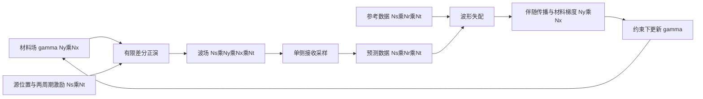

# 相控阵FWI基线选择与复现卡

**M0 决定：** 以 Singh 等人的公开传统 FWI 脚本及其二维单侧阵列设置作为第一轮复现目标。它与该论文的神经网络参数化、预训练方法共用求解器和案例，适合检查“加速发生在哪里”。独立缩小版冒烟检查已完成；2026-10-08 已执行作者 v3 四案例，每例 35 次更新。原伴随的严格离散梯度验收未通过，见 [[作者传统FWI四案例运行与梯度审计 2026-10-08]]；随后新建的离散自动微分参考在案例 1 两个状态通过，见 [[作者离散梯度参考与反演对照 2026-10-08]]。论文和软件分别见 [论文](https://link.springer.com/article/10.1007/s00466-025-02600-w) 与 [Zenodo v3](https://zenodo.org/records/14616677)。当前不声称与论文图表精确一致或全任务验证完成。

## 三个候选的取舍

| 候选 | 能直接借用什么 | 限制及本轮定位 |
| --- | --- | --- |
| Singh 等 2025 传统 FWI，[Zenodo](https://zenodo.org/records/14616677) | `conventionalFWI.py`、`AdjointMethod.py`、有限差分求解器、四个案例数据及神经版本；同一平台易公平比较 | 二维**标量**波、密度缩放场、数值数据；不是金属弹性波真实 FMC 的终点。选择为 M1 主基线 |
| Bürchner 等 2025 [TFM/RTM/FWI 对比](https://doi.org/10.1016/j.ultras.2025.107705) | 单侧线阵、二维弹性波、金属试件实测、分阶段时间窗与分割评价 | 文章使用 Salvus；未核实其完整可运行脚本与数据公开。作为后续真实物理和评价参照 |
| [ADFWI](https://github.com/liufeng2317/ADFWI) | 开源 PyTorch，包含声学、弹性及梯度核查示例 | 以地震为主要应用，需重新设计超声源、尺度与阵列观测；作为弹性阶段备选，未安装运行 |

另有 [ECNDT 2023 线阵 FWI](https://www.ndt.net/article/ecndt2023/papers/ECNDT2023_PAPER_262.pdf)：二维声速反演的六页会议论文；代码在正文中声称公开，但正文链接文本与实际仓库地址未核实，暂不作为第一基线。文中案例是水浸、上下两个 64 阵元阵列、仅 6 次发射的**仿真**，不能当作单侧 FMC 实验。见 [[相控阵FWI跨领域文献与版本记录 2026-10-07]] 的 R20。

## 目标论文和代码究竟求什么

论文使用二维标量波：

$$
\gamma(x)\rho_0\,\partial_{tt}u-\nabla\!\cdot\!\left[\gamma(x)\rho_0c_0^2\nabla u\right]=f_s(x,t).
$$

未知量为无量纲密度缩放场 $\gamma$，背景 $\rho_0=2700\,\mathrm{kg/m^3}$、$c_0=6000\,\mathrm{m/s}$ 保持固定。缺陷由小 $\gamma$ 表示。**重建图不是纵波声速图**，因而与 [[P01 U-FNO超声全波形直接反演]] 的输出不能直接逐像素比较。[论文方法](https://link.springer.com/article/10.1007/s00466-025-02600-w)

模型域为 $0.10\times0.05\,\mathrm m$，两周期 $500\,\mathrm{kHz}$ 激励；论文参考数据采用更细的 $512\times256$ 网格，反演用不同网格以减轻 inverse crime。[Zenodo 设置文件](https://zenodo.org/records/14616677/files/settings2D.csv?download=1) 给出反演设置：$N_x=255,N_y=127$，$dt=3\times10^{-8}\,\mathrm s$，$N_t=2000$，$\gamma_{\min}=10^{-5}$，四个声源。代码中源和接收点在同一侧边界，接收间隔为 6 个网格索引；由 [位置函数](https://zenodo.org/records/14616677/files/Utilities.py?download=1) 与设置表计算得到 24 个接收点。论文把这种设置描述为受 PAUT/FMC 启发；这里只使用了四次发射，**并非完整 FMC**。

论文核心目标是让源和接收波形的失配下降。[传统 FWI 脚本](https://zenodo.org/records/14616677/files/conventionalFWI.py?download=1) 用伴随梯度和 Adam 更新 $\gamma$，保存损失、材料误差和模型历史。源在网络方案中依旧通过波动方程传播；网络用来表示材料场，并未替换波动正演。

**执行后核查：** 发布设置内部材料为 256 × 128、含 ghost cells 为 258 × 130；时间为 2000 步 × 30 ns。论文第 2.2 节描述反演为 1000 步 × 60 ns，总时长一致，但时间离散不同。残差实际为 `[1,4,24,2000]`，原代价沿 `axis=2` 积分，落在接收维；时间在最后一维。已另存正确时间积分评价，未改变原始优化轨迹。

## 第一版数据流与接口

这里 $N_s=4,N_r=24,N_t=2000$ 是所选代码配置；空间维顺序以实际脚本为准。代码缓冲区含 ghost cells，`Nx+3` 和 `Ny+3` 不等于物理域采样数。需逐项核对源力、位移、时间步和材料量的单位，不在不同量纲的波形上直接比较 MSE。

完整数据加载路径：`settings2D.csv` → `data_casestudy/material1…4.h5`、`measurement1…4.h5`、`source.h5` → `FiniteDifferencePyTorchConv.py` 正演 → `AdjointMethod.py` 梯度 → `conventionalFWI.py` 优化 → 曲线和图像。Zenodo 同时给出 `data_casestudy.rar`（约 2.9 MB）及大训练包 `data.rar`（约 708.6 MB）。先取代码和案例包，不需要为了 M1 下载大训练包。[软件文件清单](https://zenodo.org/records/14616677)

## 已知复现风险与检查顺序

1. HDF5 后端 `tables` 已在 `.build/author-baseline-env` 隔离环境补齐，四案例已执行；实际依赖版本与原文件哈希均已记录。
2. 原脚本展开完整源张量；原配置已可运行，未调整源构造或数值公式。后续优化需与固定原始结果对照。
3. 论文和代码说明 PyTorch 手动种子仍不能保证跨机器完全复现。保留版本、设备、随机种子和实际数值曲线，比较趋势而非逐点相等。[软件说明](https://zenodo.org/records/14616677)
4. 所选密度缩放模型给出方法学入口。实验与金属相控阵相关的结论要等待弹性正演、真实源响应和采集数据验证。[金属相控阵实验参照](https://doi.org/10.1016/j.ultras.2025.107705)

## M1 的第一个可执行检查

2026-10-08 后续进展：同一离散正演的自动微分参考已经建立，案例 1 初始场和第 5 次更新场通过检查。原伴随的主要差异集中在阵列边界；两档学习率的 35 次新实现对照仍存在材料恢复问题，见 [[作者离散梯度参考与反演对照 2026-10-08]]。下方原伴随检查的未通过状态保留，不能将其与新参考混为一谈。

- [x] 下载必要脚本、设置和案例包；七个原文件 MD5 匹配 Zenodo 清单，另存 SHA256。
- [x] 建立隔离环境、补齐 HDF5 后端；单次更新冒烟执行后完成四案例。
- [x] 核查源、测量和材料维度，执行四案例各 35 次更新，保存曲线、材料历史与报告。
- [x] 完成案例 1 初始场的三方向、多个扰动幅度检查；正确时间积分下差异为约 28.8%、0.7%、3.7%，**检查已做但验收未通过**。
- [x] 分别标记独立冒烟程序、作者 v3 执行和实测验证；实测尚未开展。
- [x] 建立正确时间损失及同一离散正演的自动微分梯度参考，在案例 1 初始及第 5 次更新场验证；主要伴随差异已定位到阵列边界附近。
- [x] 扩展到作者四案例初始与第 5 次更新场；详见 [[四案例离散参考扩展与FNO数据接口 2026-10-08]]。
- [ ] 在更多反演状态、材料范围与激励上继续核查；边界差异的单项根因消融仍待完成。
- [ ] 对齐论文图表的时间离散设置，完成独立参考与采集物理验证。

案例 1 的离散梯度方向检查与小步长失配稳定下降已实现，可开始准备同一数值任务的基础 FNO 数据接口；定量恢复、其他案例及真实物理验证继续单独推进。下一阶段的 FNO/DeepONet 应共用同一求解器、采集几何、数据拆分和成本口径，梯度评价使用已验证的新离散参考。
