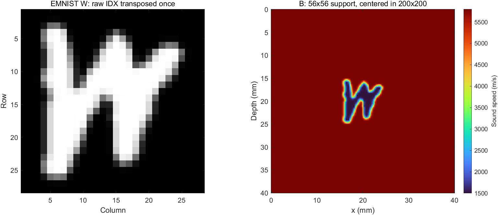

# Lu et al. 2026 超声FWI缩小版复现

## 当前进度

- **M4b预算诊断完成（最新），判定为优化/结构问题**：只改训练预算（500轮跑满、无早停、余弦1e-3→1e-6），其余与M4完全相同。耗时127.8分钟、最佳轮次463、验证L1 0.02483（M4为0.02537）。**训练集Dice仅0.4798、验证集0.4555，训练集自己都学不出字母，训练/验证差距仅0.024，且模型不如不学习的"训练集平均图"（Dice 0.5935/0.5838）**；加2.66倍预算只换来+0.013/+0.015 Dice，损失曲线最后50轮已饱和。按预定规则判为优化/结构问题，不是数据不足，故未执行扩充到2500样本。建议的局部T轴映射方案已写入报告但**未实施**。测试集未读取，M5未开始。见[M4b报告](reports/m4b_report.md)。

- **M3+M4完成，但基线未达标**：数据加载管线打通（375/40/85按冻结清单、训练集统计归一化、按需HDF5读取27.9样本/s），原版FNO2d基线26,438,321参数、batch 32、显存峰值5.30GiB、188轮/48.59分钟。**验证集相对L2=0.06259、MAE=54.56m/s、RMSE=354.08m/s、SSIM=0.95724，仅略优于恒背景参照（0.07313），且不如训练集平均图（0.05591）——只学到中心模糊团块，没有恢复字母形状。** 为使训练可行，输入按批准改为"FMC−均匀参考"的散射场（唯一偏离，理由与反证据见报告）。测试集未读取，M5未开始。见[M3+M4报告](reports/m3_m4_report.md)。

- **M2完成**：Deepwave 0.05mm/2.5ns按冻结清单生成500个EMNIST样本（训练375、验证40、测试85）及1份均匀参考。501个HDF5的SHA256和内容独立审计全部通过，异常/重试0；数据共8.297682GB，生成总跨度123.57分钟，500样本平均14.725秒。原始FMC未归一化。见[M2完成报告](reports/m2_completion_report.md)。

- **M2前两项确认完成（最新）**：0.05mm对0.025mm第32炮非对角散射L2=0.090687≤0.10，通过。确认Deepwave0.05mm/2.5ns补偿源强方案；64炮一次批次成功，含保存14.8619秒，300/500样本含20%余量预算89.2/148.6分钟。k-Wave1.25ns的20测试样本预计6.92小时（含余量）。M2尚未开始。见[确认报告](reports/pre_m2_confirmation_report.md)。

- **三炮加密裁判与消融完成（最新结论）**：用户批准均匀门槛排除自收，0.02477通过。散射非对角L2：粗Deepwave 0.21437；k-Wave dt=5/2.5/1.25 ns为0.53947/0.16891/0.11473。PML距离贡献小，粗Deepwave未过0.15；0.05 mm Deepwave作为候选，300/500样本含20%余量外推约50.9/84.8分钟，未开始M2。见[完整裁判报告](reports/adjudication_report.md)。以下门槛失败记录为修正规则前的历史。

- **几何补偿后仍在均匀门槛停止**：全接收L2=0.165013，非自收L2=0.024770；自收道占直达残差能量98.9849%。未改变<0.03门槛，未继续缺陷裁判或消融。见[补偿与残差报告](reports/refinement_compensated_report.md)。

- **加密裁判前置检查未通过**：均匀单炮粗细网格直达L2=0.449616（要求<0.03）；非自收幅度比0.500137。冻结点源公式跨网格改变了总源强，未补偿或拟合，尚不能裁决散射精度。后续三炮缺陷、时间收敛和PML消融未执行。见[本轮报告](reports/refinement_gate_report.md)。

- **M0完成**：MATLAB R2024b、RTX5070、k-Wave1.4.1；所有本次输出在E盘。
- **M1完成**：同一EMNIST模型的完整64发射参考FMC已保存。计算及检查点251.64秒，含启动/最终保存260.93秒；全局互易相对L2为1.76e-6，最坏道对8.46e-6。
- **并行可行性完成**：相同6炮在1/2/3进程下分别24.30/20.71/20.47秒；与参考波形误差均为0。暂推荐2进程，3进程额外收益未证明稳定。
- **Deepwave安装与初次对比完成**：Python3.12.15、torch2.11.0+cu128、Deepwave0.0.27均安装在E盘。初次直接共用Ricker的差异已由后续源匹配诊断进一步分析。
- **源匹配诊断完成，训练集求解器暂未确定**：推导并验证了时间导数、理论幅度和记录时序修正。均匀单炮未拟合L2=0.03496；冻结均匀校准后完整缺陷平均相关0.98807（>0.95），但散射L2=0.60276（未达到<0.2）。解析导数版本散射L2=0.56986也未通过。没有继续调参，不把Deepwave直接定为训练集求解器，也不将k-Wave视作绝对真值。
- **已推送的前两轮**：原26文件`713fdc4`；初次Deepwave对比12文件`21e82e4`。本轮源匹配诊断按用户新授权核对清单后自行轻量提交推送，单次小于5MB。
- M2批量数据已完成；M3加载与M4原版FNO已执行（基线未达标，见报告）；M5评估尚未执行。

## 报告

- [M4b训练预算诊断：迭代不足 vs 数据不足的判定](reports/m4b_report.md)

- [M3数据加载与M4原版FNO基线：指标、偏离说明与失败诊断](reports/m3_m4_report.md)

- [M2数据集完成报告、审计与原始幅度统计](reports/m2_completion_report.md)
- [M2执行前冻结协议](reports/m2_protocol.md)

- [M2前收敛确认、64炮实测与预算更新](reports/pre_m2_confirmation_report.md)

- [三炮加密裁判、时间收敛、PML消融及预算](reports/adjudication_report.md)
- [本轮执行前协议及判据修正](reports/adjudication_protocol.md)

- [几何补偿后的门槛、偏移距及频带诊断](reports/refinement_compensated_report.md)

- [加密前置检查：结果、源强推导与停止原因](reports/refinement_gate_report.md)
- [加密裁判预注册协议](reports/refinement_protocol.md)

- [源匹配诊断：推导、均匀/缺陷/散射及判据](reports/source_match_report.md)
- [源匹配执行前协议](reports/source_match_protocol.md)
- [源匹配测量与审计JSON](configs/source_match_measurements.json)
- [进度记录](reports/progress_log.md)
- [Deepwave完整对比、预算和建议](reports/deepwave_comparison.md)
- [Deepwave执行前协议](reports/deepwave_protocol.md)
- [Deepwave实测数值与环境版本](configs/deepwave_measurements.json)
- [推送与安装网络阻塞记录](reports/installation_network_block.md)
- [M0与单次发射](reports/m0_and_single_tx.md)
- [本轮预注册协议](reports/protocol.md)
- [完整FMC和互易性](reports/kwave_reference.md)
- [并行测试及300/500样本耗时估算](reports/concurrency.md)
- [Deepwave安装前方案](reports/deepwave_install_plan.md)
- [仓库交付和验证边界](reports/repository_handoff.md)
- [待提交文件清单](reports/submission_manifest.md)

## 文件与运行方法

所有本次新增版本化内容均在本子目录，未改动仓库原文件。configs/*.json包含参数及当前机器的E盘路径；迁移机器时修改路径配置。数据、MATLAB和k-Wave依赖不打包进Git。

1. `code/prepare_emnist_model.py`：从官方EMNIST Letters IDX gzip转置正立、28→56插值、补零200并映射声速。需要numpy/Pillow；示例：E盘环境的python执行 `code/prepare_emnist_model.py configs/m1_single_tx.json`。输入gzip需先置于配置指定的本地路径。已有相同标签只校验，不覆盖。
2. `code/run_m1_single_tx.ps1`与`code/m1_single_tx.m`：一次发射、场诊断和计时。PowerShell示例：`& .\code\run_m1_single_tx.ps1 -ConfigPath .\configs\m1_single_tx.json`。请传绝对配置路径以免MATLAB工作目录切换造成歧义。
3. `code/run_kwave_group.ps1`与`code/kwave_fmc_worker.m`：同一模型的指定发射集合，可用独立MATLAB进程并行。默认配置指向当前本机路径；在MATLAB启动前设置E盘缓存，并创建唯一结果目录。只在用户授权后执行。例如完整参考：`& .\code\run_kwave_group.ps1 -Processes 1 -Transmitters (1..64) -RunName kwave_reference`。少量测试可把Transmitters设为`@(1,13,26,39,52,64)`，Processes设为1/2/3。
4. `code/analyze_reference.m`：读取参考运行目录，计算2016对互易误差、检查旧第32炮一致性并生成图；MATLAB调用`analyze_reference(reference_run_dir,figure_dir)`。
5. `code/analyze_concurrency.m`：读取三个运行目录并与完整参考逐元素比较，输出吞吐量分析；MATLAB调用`analyze_concurrency(reference_run_dir,{group1,group2,group3},out_json,figure_dir)`。

并行工作器使用单炮MAT中的固定c/label/source_wavelet/time作为输入，以保证本轮参考和吞吐量比较完全相同；它不是通用批量模型生成器。上述MAT需先通过单炮脚本生成，或使用本机现有结果。图像分析脚本可能覆盖指定输出目录中的同名PNG，重分析时应提供新的图目录。

6. `code/run_deepwave.ps1`设置项目内缓存，创建唯一结果目录并调用`code/deepwave_compare.py`。先运行`-Stage smoke`，人工核验通过后才运行`-Stage full`，两者均必须传`-ConfigPath E:\FNO_research\repos\fno_light\repro_lu2026\configs\deepwave_comparison.json`。环境解释器固定在配置root下的`envs/deepwave/Scripts/python.exe`，不自动安装或编译。full执行64炮对照和分析，不生成多模型训练集；仅OOM时允许16炮分批。

7. `code/run_source_match.ps1`和`code/source_match.py`：先使用`source_match_single.json -Stage single`进行均匀单炮源修正与校准，再使用`source_match_full.json -Stage full`做完整两介质对照。参数必须传绝对配置路径。`kwave_homogeneous.json`用于原k-Wave工作器的均匀介质覆盖选项；未提供该选项时旧缺陷模式不变。`code/analyze_source_match.py`读取`source_match_audit.json`，仅分析已有数组，不重新传播；本轮剩余差异未通过判据，不自动启动M2。

## 时间与物理约定

常密度1000kg/m³，声速1500–5800m/s，只做纵波声学模型。56像素支撑宽11.2mm是依据Lu图5的实现假设。四边外置20点PML、无底面反射是对原文未明确上下边界的处理。

dt=5ns，内部4000点；输出每4点抽取，1000点覆盖0–19.98μs。t=0为采集启动；Ricker解析峰值延迟1.333333μs，离散峰1.335μs。后续实测数据须标定触发和换能器延迟，不自动视为对齐。

8. `code/run_refinement_gate.ps1`与`code/refinement_gate.py`仅执行冻结源的加密均匀单炮检查；运行方式见[报告](reports/refinement_gate_report.md)。不会自动继续缺陷传播。

9. `code/run_adjudication_deepwave.ps1`、`code/run_adjudication_kwave.ps1`运行本轮固定三炮；`code/analyze_adjudication.py`只分析保存结果。运行方法与输入配置见[裁判报告](reports/adjudication_report.md)。

10. `code/run_pre_m2_convergence.ps1`和`code/run_pre_m2_throughput.ps1`分别执行更细参考检查和通过后的64炮吞吐确认；参数与复现命令见[确认报告](reports/pre_m2_confirmation_report.md)。

11. `code/prepare_m2_manifest.py`冻结500样本划分；`code/run_m2.ps1`调用`generate_m2.py`执行pilot或bulk并支持严格校验后的断点续跑；`code/audit_m2.py`对完成数据重算SHA256及汇总原始幅度；`code/report_m2.py`从审计JSON生成完成报告。固定配置、清单、逐文件账本和统计见`configs/m2_*.json`，运行方法见[M2完成报告](reports/m2_completion_report.md)。数据、日志、环境和原始EMNIST不入Git。

12. `code/m3_data.py`负责M3：`norm`/`norm_scatter`拟合归一化参数（只用训练集）、`stats`汇总原始/归一化/散射幅度、`viz`画三张预览图、`load`测按需加载吞吐；`code/m4_fno.py`负责M4：`bench`测单步与预算、`overfit`跑8样本门禁、`train`正式训练（每10轮存`last.pt`，`train.resume=true`时自动续训）。所有阶段统一用`code/run_m3_m4.ps1 -ConfigPath <绝对配置> -Stage <阶段>`，该脚本仅在本进程内把缓存/TEMP重定向到E盘。参数与路径见`configs/m3_m4_fno.json`，归一化参数与指标见`configs/m3_normalization.json`、`configs/m3_scatter_normalization.json`、`configs/m3_measurements.json`、`configs/m4_measurements.json`，结果与诊断见[M3+M4报告](reports/m3_m4_report.md)。权重、日志、数据不入Git。

13. `configs/m4b_fno.json`是M4b预算诊断配置（由M4配置程序化派生，只改轮数/早停/学习率衰减/保存策略）；训练同用`code/run_m3_m4.ps1 -Stage m4-train`，结果写入新的`m4b_train_*`目录，图前缀为`m4b_`，不覆盖M4。`code/m4b_diagnostics.py <M4目录> <M4b目录>`只读取两边已保存的`best.pt`，在训练集与验证集上重算相对L2/MAE/RMSE/SSIM及缺陷区MAE、Dice、IoU，并对照"恒背景"和"训练集平均图"两个无学习参照，输出`configs/m4b_diagnostics.json`与对比图。判定与结论见[M4b报告](reports/m4b_report.md)。
