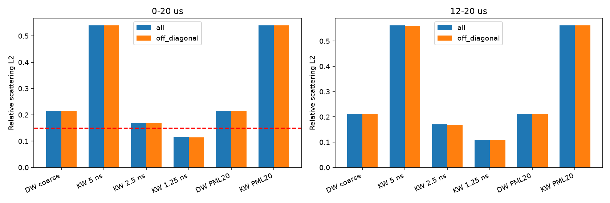
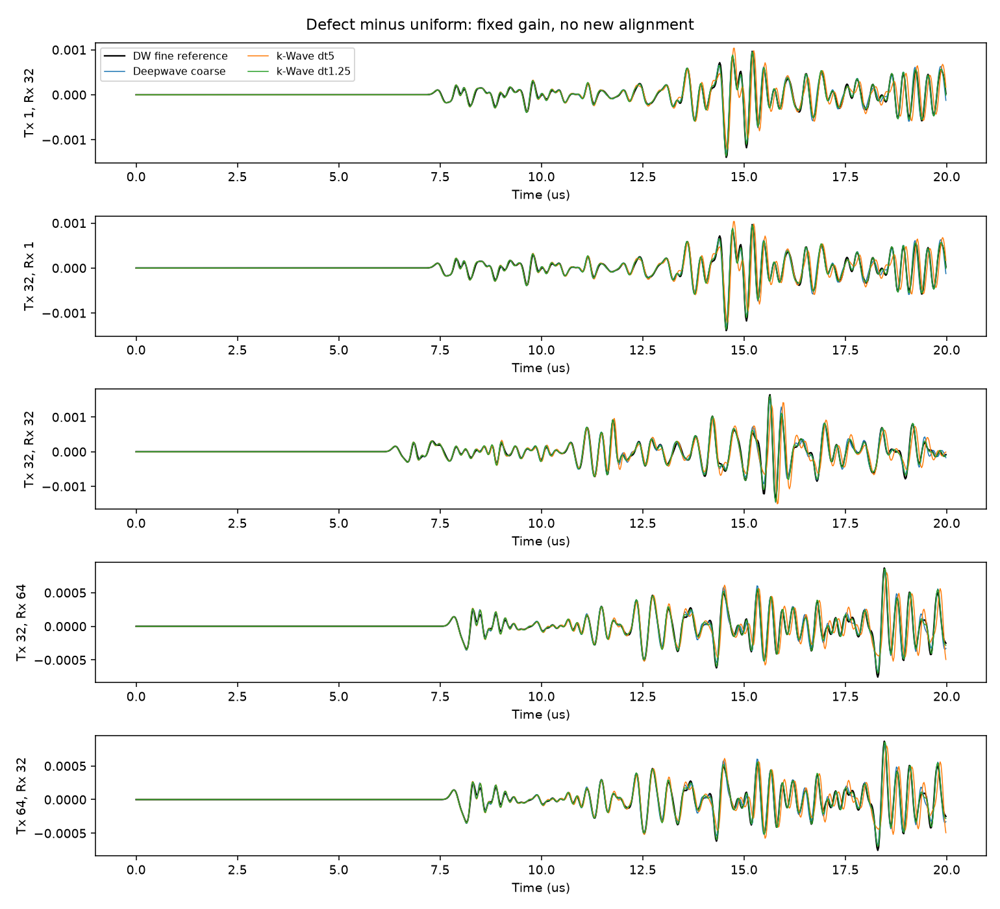

# 三炮加密裁判、时间收敛与PML距离消融

2026-10-19。**相对本次加密Deepwave散射参考，粗Deepwave的非对角L2=0.214373，优于原k-Wave 5 ns的0.539468，但没有通过0.15阈值。k-Wave减dt到1.25 ns后降至0.114727，比粗Deepwave更接近本次参考。** PML距离变体几乎不改变这一结论。按预定规则，将0.05 mm Deepwave列为候选训练方案并给预算；没有开始M2。

## 判据修正与冻结条件

用户本轮明确将均匀门槛改为“排除自收道后全局相对L2<0.03”，已有0.02477001855通过。依据是二维理想点源源点的奇异近场/自响应依赖网格正则化，不适合用作跨网格传播门槛。这是**用户批准的判据修正**，不是本轮事后删除误差道；[此前含自收门槛失败报告](refinement_compensated_report.md)保留。

散射场仍两版都报：全部192条道与排除三条自收后的189条道，决策只用后者。散射为同一求解器、同一参数下“缺陷−均匀”；自收的共同直接响应会相消，所以散射指标两版差别很小，但不据此修改其他规则。

源、模型、坐标不再拟合：

- 同一200×200 EMNIST标签，粗网格重复2×2，加密重复4×4；高声速5800、低声速1500 m/s，常密度声学。
- Deepwave accuracy=8；细网格h=0.05 mm、dt=2.5 ns、800×800、8000步，四边40点PML=2 mm。粗h=0.1 mm、dt=5 ns、400×400、20点PML。
- 细源 `f_f[n]=-2 h_c/(c_s h_f² dt_f) × (r[n+1]-r[n])`。单点等效源密度空间积分约为 `f h²`，故相对旧细网格公式乘 `h_c/h_f=2`，保持与粗网格物理总强度一致。
- 两档Deepwave共用冻结增益0.9907679913977262、零时移。k-Wave沿用等效的一阶additive Ricker，在新dt上采样，不把导数再注入一阶系统。Ricker频率2.25 MHz、解析峰延迟3/f0=1.333333 μs，采集t=0不变。
- k-Wave仍固定sound_speed_ref=5800 m/s，PMLAlpha=2；PML变体顶部补18行背景，阵列深度索引2→20，模型和阵列一起平移，底部不裁切，域418×400。DW pml_freq沿用2.25 MHz。两求解器PML算法不同，没有强称数学等价。
- 三炮固定1/32/64，每炮64接收。全部整数抽取到20 ns、1000点。预注册协议见[这里](adjudication_protocol.md)。

## 汇总：排除对角线（决策使用）

全窗为0–19.98 μs，晚期为12≤t<20 μs。L2分母是加密散射参考的范数；全局相关为所有纳入样本合并后的去均值Pearson，另报逐道同时刻Pearson平均，无新幅度或时移拟合。

| 方案 | 全窗L2 | 全局相关 | 逐道相关均值 | 12–20 μs L2 | 晚期全局相关 | 三炮缺陷/均匀/合计 秒 |
|---|---:|---:|---:|---:|---:|---:|
| Deepwave coarse | 0.214373 | 0.977073 | 0.978349 | 0.212448 | 0.977375 | 0.104/0.105/0.209 |
| k-Wave dt5 | 0.539468 | 0.855082 | 0.850695 | 0.561275 | 0.842226 | 12.221/17.030/29.251 |
| k-Wave dt2.5 | 0.168910 | 0.985931 | 0.985135 | 0.169557 | 0.985716 | 24.531/23.262/47.793 |
| k-Wave dt1.25 | 0.114727 | 0.993561 | 0.993978 | 0.108830 | 0.994143 | 48.672/46.760/95.432 |
| Deepwave PML20 | 0.214424 | 0.977061 | 0.978336 | 0.212496 | 0.977363 | 0.100/0.093/0.193 |
| k-Wave PML20 | 0.539549 | 0.855038 | 0.850650 | 0.561361 | 0.842178 | 12.325/12.286/24.612 |

## 汇总：含对角线（完整披露）

| 方案 | 全窗L2 | 全局相关 | 逐道相关均值 | 12–20 μs L2 | 晚期全局相关 | 三炮缺陷/均匀/合计 秒 |
|---|---:|---:|---:|---:|---:|---:|
| Deepwave coarse | 0.214457 | 0.977056 | 0.978343 | 0.212543 | 0.977356 | 0.104/0.105/0.209 |
| k-Wave dt5 | 0.539935 | 0.854855 | 0.850691 | 0.561936 | 0.841881 | 12.221/17.030/29.251 |
| k-Wave dt2.5 | 0.169241 | 0.985877 | 0.985098 | 0.169976 | 0.985647 | 24.531/23.262/47.793 |
| k-Wave dt1.25 | 0.115067 | 0.993523 | 0.993942 | 0.109184 | 0.994105 | 48.672/46.760/95.432 |
| Deepwave PML20 | 0.214522 | 0.977041 | 0.978328 | 0.212607 | 0.977341 | 0.100/0.093/0.193 |
| k-Wave PML20 | 0.540016 | 0.854812 | 0.850645 | 0.562022 | 0.841832 | 12.325/12.286/24.612 |

加密裁判自身三炮：缺陷0.385458秒、均匀0.569222秒，合计0.954680秒。表中Deepwave计时包含GPU传播及CPU回传；k-Wave计时为solver调用，不含回传/保存/启动，口径略有差异。k-Wave 5 ns是对应三炮的旧计时汇总，均匀第32炮来自独立进程，包含较多首次调用开销；不能将其与PML20之间的耗时差当作稳定加速。其余k-Wave均为本轮实测三炮。Deepwave先运行细均匀，所以其首次调用成本较大；短时GPU计时不提供统计置信区间。

## 时间收敛与PML的贡献

k-Wave非对角全窗L2随dt减小：**0.539468 → 0.168910 → 0.114727**；晚期也从0.561275降到0.169557、0.108830。三个发射各自也都有同方向改善，逐炮值保存在测量JSON中。

相邻时间步解的差异，以固定加密参考范数归一化，分别为0.455968和0.117742，比值3.8726，接近dt减半时二阶时间误差差分的4倍趋势。该趋势支持原k-Wave差异中有显著时间离散贡献，与此前c_ref相位误差假设相容；但实验改变dt时一阶系统时间推进、源离散和PML离散同时改变，**不能把全部改善独占归因于c_ref修正**。

移动顶部PML后的散射变化：

| 变体 | 相对本求解器原散射的变化范数 | 相对加密裁判范数的变化 | 原→变体裁判L2 |
|---|---:|---:|---:|
| Deepwave PML20 | 0.00279348（0.2793%） | 0.00279939 | 0.214373→0.214424 |
| k-Wave PML20 | 0.00012915（0.0129%） | 0.00012967 | 0.539468→0.539549 |

该消融说明：在本模型、三炮与20 μs窗口里，**顶部PML距离不是剩余散射差异的主要解释**。这是差分散射场结论，不能据此断言所有直接场边界效应为零，也没有验证其他PML厚度/算法。

## 固定决策与剩余不确定性

1. 粗Deepwave相对原k-Wave 5 ns误差减少约60.26%，但非对角L2=0.214373 >0.15，因此**不满足推荐0.1 mm Deepwave训练集的条件**。不能只凭相关0.977或速度快就放宽阈值。
2. 触发第二条：报告0.05 mm Deepwave作为候选训练方案的预算，见下表。优先候选是加密Deepwave，而不是未达阈值的粗Deepwave；用户尚未选择或授权M2。
3. k-Wave减dt明确向本次参考靠近，故不触发“两者都不向裁判解收敛”的停止分支。本轮计划已完成，仍按要求停止，不新增实验。

裁判只是一档加密Deepwave，**不是已证明完全收敛的真解**；这次只能比较与它的接近程度。粗Deepwave仍有空间/时间离散与强对比界面表示误差；加密同时改变h和dt，未单独分离二者。k-Wave 1.25 ns与参考仍有约11.47%的差异，可能包括空间离散、界面与源/记录时序的残余差别及参考误差，当前没有足够证据进一步定量拆分。共享同一200标签保证几何来源一致，不保证不同网格的界面离散误差为零。

## 加密Deepwave的300/500样本候选预算

仅实测三炮批次，没有运行加密全64炮或新模型。使用本次缺陷三炮0.385458秒，按最多3炮一批、64炮共ceil(64/3)=22批外推：单样本传播回传约8.480秒；加20%工程余量约10.176秒。最后一批实际只有1炮，按完整三炮计入。均匀介质固定，可预先生成一次参考，无需每个缺陷样本重算；同样外推该64炮均匀参考约12.52秒。

| 样本数 | 传播回传线性外推 | 加20%余量的计划值 | float32 FMC+200²标签数据量 |
|---|---:|---:|---:|
| 300 | 42.40分钟 | 50.88分钟 | 4.9632 GB（4.62 GiB） |
| 500 | 70.67分钟 | 84.80分钟 | 8.2720 GB（7.70 GiB） |

以上不含训练、长期运行时钟/温度波动、每样本读写与环境启动的实测成本；20%是明确的计划余量，不能视为已测端到端保证。数据量按每样本64×64×1000×4 + 200×200×4字节，不含文件头与参数，也不保存8000点内部波形；若每个样本都存内部波形，体积会显著增加。三炮细网格Torch分配峰值约83.72 MiB，整卡轮询峰值1887 MiB；未做64炮细网格显存测试，不据此承诺一次64炮批处理。

## 执行、核查与复现

- 本轮Deepwave 6组三炮（细/粗/PML20，各均匀和缺陷），完整进程3.954秒；k-Wave六个进程墙钟合计214.932秒（含启动保存），总计约218.886秒。运行无失败重算、无OOM；报告/绘图时间另计。粗Deepwave重跑用于三炮计时和旧数据核验，不是新增模型或调参。
- 粗Deepwave两种介质与旧64炮中对应三炮逐点一致；细均匀第32炮与已通过门槛的数据逐点一致。
- 检查了模型精确重复与PML顶部平移、Ricker采样、输出时间轴、所有数组有限值、参考输入SHA256。独立平方能量公式复算全部六行非对角L2，与主分析一致；掩码确认为189道。两张PNG已查看。
- 报告汇编时发现Windows默认编码导致表格文件按UTF-8读取失败一次；使用其实际GB18030编码读取历史表格，后续表格生成明确使用UTF-8。只修正文档编码，没有重跑传播或改动指标。
- [总配置](../configs/refinement_adjudication.json)、[分析配置](../configs/adjudication_analysis.json)、[测量JSON](../configs/adjudication_measurements.json)。每个k-Wave变体另有配置，原标签/数据文件不修改。
- Deepwave：`& .\code\run_adjudication_deepwave.ps1 -ConfigPath E:\FNO_research\repos\fno_light\repro_lu2026\configs\refinement_adjudication.json`。
- k-Wave：`& .\code\run_adjudication_kwave.ps1 -ConfigPath E:\FNO_research\repos\fno_light\repro_lu2026\configs\refinement_adjudication.json`。六组按顺序运行，遇错停止，不自动重试。
- 分析脚本`code/analyze_adjudication.py`接收分析配置与一个新建的E盘输出目录；配置中的运行目录需对应实际结果。分析不传播，HDF5以独占创建方式避免覆盖已有结果。
- 本地数组：`E:/FNO_research/results/adjudication_deepwave_20261019_190907_081/`，k-Wave目录索引在`E:/FNO_research/results/adjudication_kwave_20261019_190923_203/runs.json`，分析在`E:/FNO_research/results/adjudication_analysis_20261019_191315_225/`。日志位于项目logs目录。数据均不入库。
- 全部新增输出在E:/FNO_research；未安装软件、未修改全局代理或Git配置、未开始M2。
