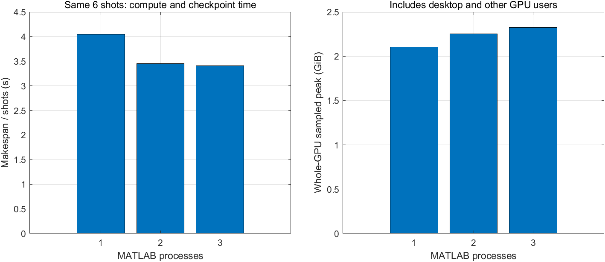

# 同GPU多MATLAB进程：小规模吞吐量测试

完成日期：2026-10-19。按预注册顺序，在完整64炮参考样本结束后，分别启动1、2、3个独立MATLAB进程。

固定测试发射集合为[1,13,26,39,52,64]，每档合计6炮，每档只做一轮。各进程初始化GPU和小FFT后通过文件屏障同时开始；发射位置不重叠。计时包含求解、接收数据回传和逐炮检查点保存；另列包含启动/退出的完整时间。

| MATLAB进程数 | 6炮计算跨度 | 含启动/退出总时间 | 炮/秒 | 相对单进程吞吐量 | 整卡显存采样峰值 | GPU利用率采样均值 |
|---|---:|---:|---:|---:|---:|---:|
| 1 | 24.302s | 31.753s | 0.2469 | 1.000× | 2153MiB | 41.8% |
| 2 | 20.714s | 28.657s | 0.2897 | **1.173×** | 2305MiB | 75.3% |
| 3 | 20.470s | 29.688s | 0.2931 | **1.187×** | 2380MiB | 76.1% |

全部18次测试发射与对应参考信号的相对L2误差均为0，未发生GPU错误，没有自动回退CPU或安装其他软件。

结论：2和3进程均能运行，显存不是本次限制。并行吞吐量没有随进程数成比例增长。3进程比2进程计算跨度只改善约1.2%，而包含启动的总时间反而稍长；一轮小样本不足以认定这点差异稳定。**若采用k-Wave批量正演，暂优先2进程**；更长期测量前不声称3进程更优。

显存每500ms采样，统计整卡而非MATLAB专属分配量，包含桌面及其他GPU使用者；可能漏掉短暂峰值。这里没有使用额外GPU、MPS或CUDA软件安装。

## 300/500样本外推

| 方案 | 完整64炮/样本 | 300样本 | 500样本 | 加20%余量：300 / 500 |
|---|---:|---:|---:|---:|
| k-Wave单进程，完整64炮实测外推 | 4.194分钟 | 20.97小时 | 34.95小时 | 25.16 / 41.94小时 |
| k-Wave双进程，6炮小样本外推 | 3.682分钟 | 18.41小时 | 30.69小时 | 22.09 / 36.82小时 |
| k-Wave三进程，6炮小样本外推 | 3.639分钟 | 18.20小时 | 30.33小时 | 21.83 / 36.39小时 |
| Deepwave，全64炮批处理 | **未测** | T/12小时 | 5T/36小时 | 安装获批并测得T秒后再算 |

单进程使用完整64炮的251.643秒，而并行档使用6炮吞吐量外推，所以不能把该表的差值当成严格同样本加速比；同条件加速比应看上表。假设保持MATLAB进程并跨样本复用，不每炮重启，尚未包含不同模型带来的波动；20%余量只是预算。

批量仅保存1000点float32 FMC和200×200标签时，300/500样本的数据体积约4.62/7.70GiB，建议预留6/10GiB，不包括环境、原始数据和额外诊断。当前参考样本为对照用途额外保存4000点原始信号，不按其69.97MiB文件大小外推训练数据集。

Deepwave尚未安装，不能给出真实吞吐量、显存、波形误差或叠加图；下一步受用户明确要求的安装确认约束，详见[安装方案](deepwave_install_plan.md)。本轮未运行任何批量模型数据集。

## 复查范围

三个档位的输出均重新加载，与参考对应炮逐元素一致；图表已打开查看。测试运行目录分别为本机results下`concurrency_p1_20261019_162359_356`、`concurrency_p2_20261019_162431_236`和`concurrency_p3_20261019_162459_965`。其MAT、日志、监控CSV仅保留本机。
