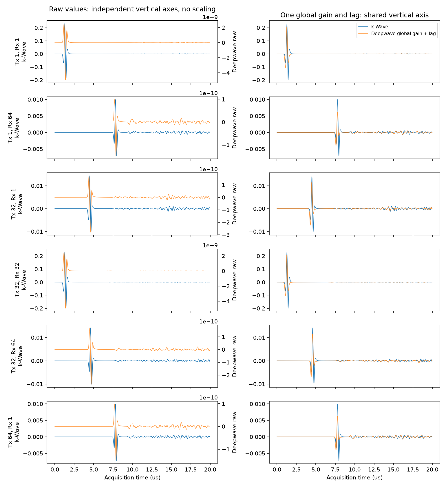
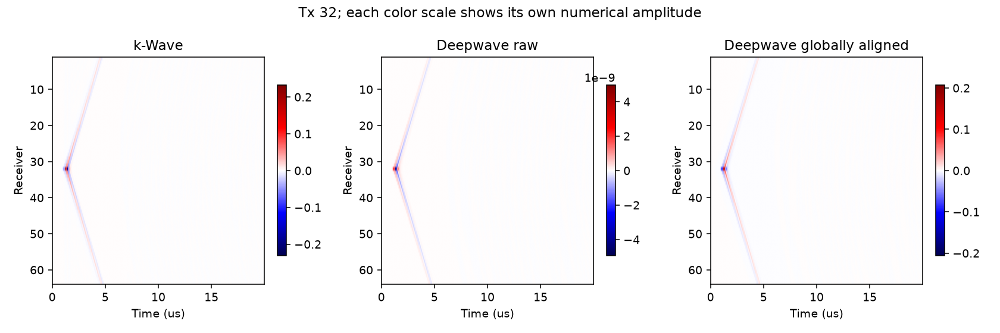

# Deepwave 与 k-Wave：同模型64炮对比

**历史阶段报告。后续[源匹配诊断](source_match_report.md)已验证导数修正，但散射判据仍未通过；最终训练集求解器暂未确定。下文保留首次直接使用同Ricker时的结果与当时建议。**

2026-10-19。已完成批准的安装、单炮GPU验证和完整64炮比较。**没有启动M2批量数据集。建议当前基线训练集继续用k-Wave双进程；Deepwave先作为待做物理源匹配的快速备选。**

## 环境与安装

便携CPython **3.12.15** 位于 `E:/FNO_research/envs/cpython-3.12.15/python`；虚拟环境位于 `E:/FNO_research/envs/deepwave`。安装 **torch 2.11.0+cu128 / deepwave 0.0.27**，以及numpy 2.5.4、h5py 3.16.0、matplotlib 3.11.2等预编译wheel。完整版本清单、测量和输入哈希见[JSON记录](../configs/deepwave_measurements.json)。pip check通过。

GPU为RTX5070，计算能力12.0；torch架构列表包含sm_120。所有新环境、缓存、临时文件、日志和结果均指定到项目E盘路径；没有安装CUDA Toolkit或编译器，也未使用源码构建、torch.compile或Python JIT传播后端。wheel自带CUDA运行依赖，不等于安装系统CUDA Toolkit。没有做操作系统级写盘审计，不把路径控制表述为全盘审计结论。

Python基础目录约0.140GiB，虚拟环境约4.435GiB，pip缓存约0.068GiB，保留的torch wheel约2.564GiB，另有Python压缩包约44.2MiB；上述约7.25GiB。保留缓存，没有清理用户文件。

网络恢复后原26文件已推送，提交号 `713fdc4d6d7ceec9f7c6ba4a0a98e440cda0d1c7`。pip首次下载torch在约1.2GB处读取超时，约耗时3.5分钟；第二次用curl从同一官方URL下载到E盘，约4分钟完成，SHA256为 `7c78215c3af4f62e63f2b2e360f1722fc719b0853c7ac22666483d9810613a4c`。随后本地wheel安装成功，没有第三次下载尝试。失败日志保留在本机logs，历史GitHub连接失败另见[记录](installation_network_block.md)。

## 可运行性与同一输入验证

均匀5800m/s、100×100网格、单炮1000步测试通过：原生CUDA传播0.534秒，输出有限且非零。该测试仅证明可运行，不是收敛性或PML精度证明。

完整模型采用已确认的400×400声速图、64点阵列、0.1mm网格、8阶空间差分、5ns×4000步、四周20点PML，无梯度，一次批处理64炮。**没有OOM或分批回退。** Deepwave CFL函数返回内部步长5ns、细分比1，因此没有隐式时间插值。输出按每4点取1点保存为64×64×1000。

与参考文件逐项核对：声速完全相同，范围1500–5800m/s；源波形按实际求解的float32精度完全相同；保存的1000点数据与4000点数据抽取严格相等。审计初次直接比较MAT中float64存储的源数组与float32输入触发断言；核对k-Wave代码的`single(source_wavelet)`后按真实输入精度比较通过，未修改波形或重跑仿真。参考MAT读取时逆转HDF5维度，模型保持[深度,横向]，FMC保持[发射,接收,时间]。

## 耗时、显存和互易性

| 指标 | k-Wave单进程参考 | Deepwave一次64炮 |
|---|---:|---:|
| 求解器累计 / 传播及回传 | 249.450s（求解器累计） | 2.145s（含回传） |
| 计算及检查点 / 生成并保存 | 251.643s | 2.627s |
| Python脚本启动至数据保存（含导入） | 不适用 | 3.945s |
| 完整进程时间 | 260.926s | 8.304s（包含误差分析、绘图） |
| 整卡显存采样峰值 | 2173MiB | 2036MiB |
| PyTorch峰值allocated / reserved | 不适用 | 465.94 / 490.00MiB |
| 全局互易相对L2 | 1.7589e-6 | 2.7237e-6 |
| 2016对互易误差均值 / 最大值 | 3.8974e-6 / 8.4614e-6 | 5.9878e-6 / 1.3966e-5 |

整卡显存每0.5秒采样，包含桌面等其他使用者，可能漏掉短暂峰值；PyTorch值是进程分配器统计，二者不能混用。Deepwave完整运行全部输出有限。这里只测一个模型、一次64炮；不同计时范围和运行时开销意味着不宜把约百倍速度差当作跨数据集稳定加速比。互易误差小也不证明两个求解器物理等价。

## 原始与全局标定后的波形

严格按[预注册协议](deepwave_protocol.md)，原始数据保留，另外只拟合一个全局有符号幅度系数和一个整数时移。使用所有4096道、完整1000点窗，没有逐道标定、滤波、求导或积分。

| 指标 | 原始Deepwave | 全局幅度+时移标定 |
|---|---:|---:|
| 全局相对L2（k-Wave为分母） | 0.9999999996 | **0.541836** |
| 逐道相对L2均值 / 中位数 | 1.000000001 / 1.000000000 | 0.559783 / 0.552511 |
| 逐道相对L2 P95 / 最大值 | 1.000000003 / 1.000000004 | 0.614933 / 0.654822 |
| 同时刻去均值相关系数均值 / 中位数 | -0.034857 / -0.000378 | **0.828967 / 0.833805** |
| 同时刻相关系数最小 / 最大值 | -0.230764 / 0.034475 | 0.766456 / 0.845983 |

原始数值峰值：k-Wave约0.231715，Deepwave约4.94868e-9，未统一物理源单位，不能直接把其差值归因于传播误差。原始逐道±0.5μs范围内峰值绝对归一化互相关均值0.840893、中位数0.840067；对应有符号值和各道lag保存在comparison.h5，**逐道lag没有用于改动波形**。这里峰值指标取绝对值，会隐藏极性，必须与原始零lag有符号相关一起读。

拟合得到全局系数 **-4.1736617e7**，全局lag **-5个输出采样点=-100ns**。定义是将Deepwave提前100ns并乘上述系数，末尾5点补零，所有1000点仍参与评分。参考和原始Deepwave的采集t=0均未改写，Ricker解析峰值仍延迟1.333333μs。拟合用的就是同一参考样本，结果偏乐观，不能当作跨模型标定。

左列为原始值，**双纵轴分别显示两种原生幅度量级，零线也不保证重合**；没有据此缩放保存数据。右列采用同一纵轴显示全局标定后的真实残差。所有六道使用同一个系数和时移。

各面板使用各自标注的数值色标，不能用颜色深浅比较物理幅度。强直达波主导全窗指标；没有单独评价弱缺陷散射窗。

## 为什么一个幅度系数和时移不够

检查安装版Deepwave scalar.py：源输入在传播前乘以`-v² dt²`，进入二阶波场更新；其接收记录与源施加存在离散时间步次序。源码接口见[Deepwave scalar](https://github.com/ar4/deepwave/blob/v0.0.27/src/deepwave/scalar.py)。本地k-Wave1.4.1的`kspaceFirstOrder_scaleSourceTerms.m`则对加性压力源按`2 dt/(N c dx)`转换并加入分裂密度场，还应用k-space源修正。

从常密度的一阶压力/速度方程消去速度时，加在压力一阶方程中的源会以时间导数进入二阶压力方程。因此，两边直接输入同一个Ricker数组，通常不是相同的二阶物理forcing；不仅幅度单位不同，频率/相位形状也会不同。拟合的负号和约100ns提前量与补偿这类差异相容，**不能解释成测得真实触发延迟**。本次没有做源导数/积分转换，也没有证明54%的剩余误差分别由哪些因素贡献。

还存在8阶有限差分与k-space伪谱的离散差异、两种PML实现和接收时序差异。尤其低声速区6MHz波长约0.25mm，对0.1mm网格只有2.5点，不能把k-Wave的网格经验直接当作8阶有限差分的收敛证明。k-Wave是本任务参考，不是绝对真值。

## 300/500样本预算与建议

| 方案与口径 | 秒/64炮样本 | 300样本 | 500样本 | 加20%余量：300 / 500 |
|---|---:|---:|---:|---:|
| k-Wave单进程，完整样本实测 | 251.643 | 20.97h | 34.95h | 25.16 / 41.94h |
| k-Wave双进程，6炮吞吐量外推 | 220.949 | 18.41h | 30.69h | 22.09 / 36.82h |
| Deepwave，复用进程的生成+保存口径 | 2.627 | 13.13min | 21.89min | 15.76 / 26.27min |
| Deepwave，每模型重新导入的脚本口径 | 3.945 | 19.73min | 32.88min | 23.67 / 39.45min |

Deepwave预算不逐样本重复画图或计算对照误差，未包括尚未实现的M2调度、模型预处理和不同模型波动。每次Python进程启动的额外操作系统开销也未计入脚本口径。20%只是预算余量，非置信区间。参考输入还包含4000点额外数据；训练集只保存1000点FMC及200×200标签时，300/500样本约4.62/7.70GiB（建议预留6/10GiB）。

**当前建议：k-Wave双进程生成本阶段训练集。** 理由是它与已验证参考逐元素一致，输入约定连续，预计22–37小时（含20%预算余量）仍可执行。Deepwave值得保留：一次64炮可行、显存低、速度优势显著，但当前只做幅度+时移仍有54.2%全局差异，不宜悄然替换求解器或混合两类数据。后续如选择Deepwave，应先单独批准并验证等效物理源、网格收敛和散射波窗，再生成其自身一致的数据集。本轮不开展这些额外实验。

## 本机产物与复查

运行目录：`E:/FNO_research/results/deepwave_full_20261019_172629_796`。deepwave_fmc.h5包含原始4000点及1000点FMC、声速、源和时间轴，82,592,192字节；comparison.h5包含独立的标定数据和逐道指标。数据SHA256为`b6bcc01b9da90d976b7517a2cca26cc55d91bd29c8d0ea3f6a30f27150a8cbb5`。大文件不入仓库。

两张PNG已打开核对，分别271,123和227,265字节，均小于1MB。独立复读验证原始抽取、float32输入一致及标定数组的平移/零填充/系数；k-Wave互易性重新计算与既有记录一致。代码、协议、配置和关键图留在本地，待清单批准后再推送。
