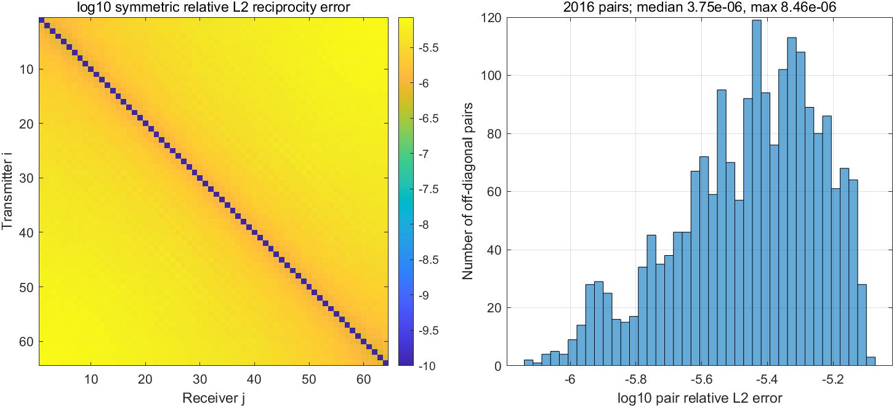
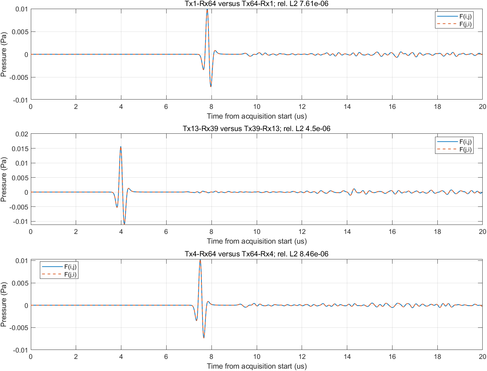
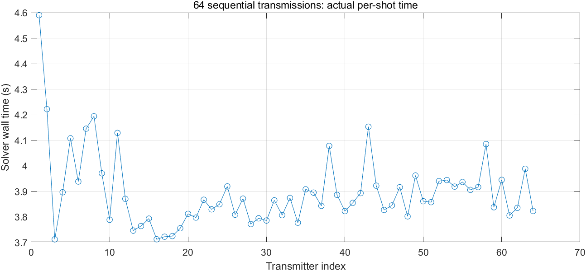

# k-Wave 完整64发射参考样本

完成日期：2026-10-19。仅完成同一声速模型的64发射，没有生成300/500模型数据集。

## 结果

| 项目 | 实测 |
|---|---:|
| 完成发射 | 64/64 |
| 计算及逐炮检查点保存 | 251.643秒（4.194分钟） |
| 整个运行，含进程启动、最终保存及退出 | 260.926秒（4.349分钟） |
| 求解器累计时间 | 249.450秒 |
| 每炮求解均值/中位数 | 3.898 / 3.866秒 |
| 整卡显存采样峰值 | 2173MiB |
| GPU利用率采样均值 | 43.85% |
| 输出形状 | 64×64×1000，float32 |
| 参考文件大小 | 73,371,907字节（约69.97MiB，含额外4000点原始信号） |

本次只记录接收压力，关闭全场极值和绘图，并持续复用同一MATLAB/GPU进程，因此不能直接拿每炮时间与上一轮带全场诊断的9.62秒作同条件性能对比。实测结果取代原先约12分钟的保守预算。

参考模型：EMNIST Letters train索引0，正立W；28→56→居中补零200；背景5800m/s、字母1500m/s、常密度1000kg/m³。56×56对应11.2mm支撑区域，是依据Lu图5的实现假设。四边外置20点PML属于原文仅交代侧边PML时的明确偏差，不模拟底面/自由表面反射。

网格0.1mm，物理域400×400，含PML的实际网格440×440。dt=5ns、4000点；输出每4点抽取，0–19.98μs。采集启动为t=0，Ricker解析峰值延迟1.333333μs，离散峰1.335μs，不平移数据。

## 互易性

全局指标为 `||F-permute(F,[2,1,3])||F / ||F||F`。每对i<j使用 `||Fij-Fji||2 / ((||Fij||2+||Fji||2)/2)`，排除恒为零的对角线。

| 指标 | 数值 |
|---|---:|
| 全局相对L2 | **1.75886×10⁻⁶** |
| 非对角道对数 | 2016 |
| 道对误差均值 | 3.89736×10⁻⁶ |
| 中位数 | 3.75366×10⁻⁶ |
| 95百分位 | 6.99967×10⁻⁶ |
| 最大值 | **8.46143×10⁻⁶**，第4/64阵元对 |
| 最大逐点绝对差 | 9.68575×10⁻⁸ Pa |
| 最小道对平均L2范数 | 0.0273944 Pa（离散向量范数） |
| 第32炮相对上一轮单炮的L2差 | **0** |

这说明该参考样本的源/接收顺序、重复计算和互易性在本次数值精度下相容。它不替代空间收敛或PML反射定量验证，也不代表与弹性实验完全等效。

## 数据留存与验证

数据仅在本机：`E:/FNO_research/results/kwave_reference_20261019_161842_022/worker_1/fmc.mat`。

- `fmc`：发射×接收×1000时间点；`fmc_internal`：发射×接收×4000内部时间点。
- 同时保存c、label、source_wavelet、时间轴、配置和运行元数据；MAT v7.3。
- SHA256：`2D63F17DAB64E3D40236D9A1597FD1BB5728E563A7828E53BD85488CDCA75C52`。
- 每炮检查点位于同级`shots/`，监控与文本日志位于本机`logs/kwave_reference_20261019_161842_022/`。
- 每炮检查有限值；最终文件重新打开检查形状；第32炮与旧结果完全一致。三张参考分析图均已打开检查，单张小于1MB。

Git只保存代码、参数和本报告/关键图片，不包含以上MAT、日志或原始论文。
