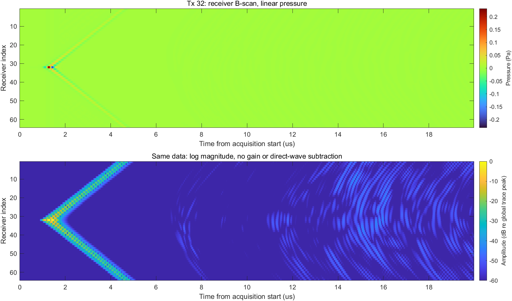
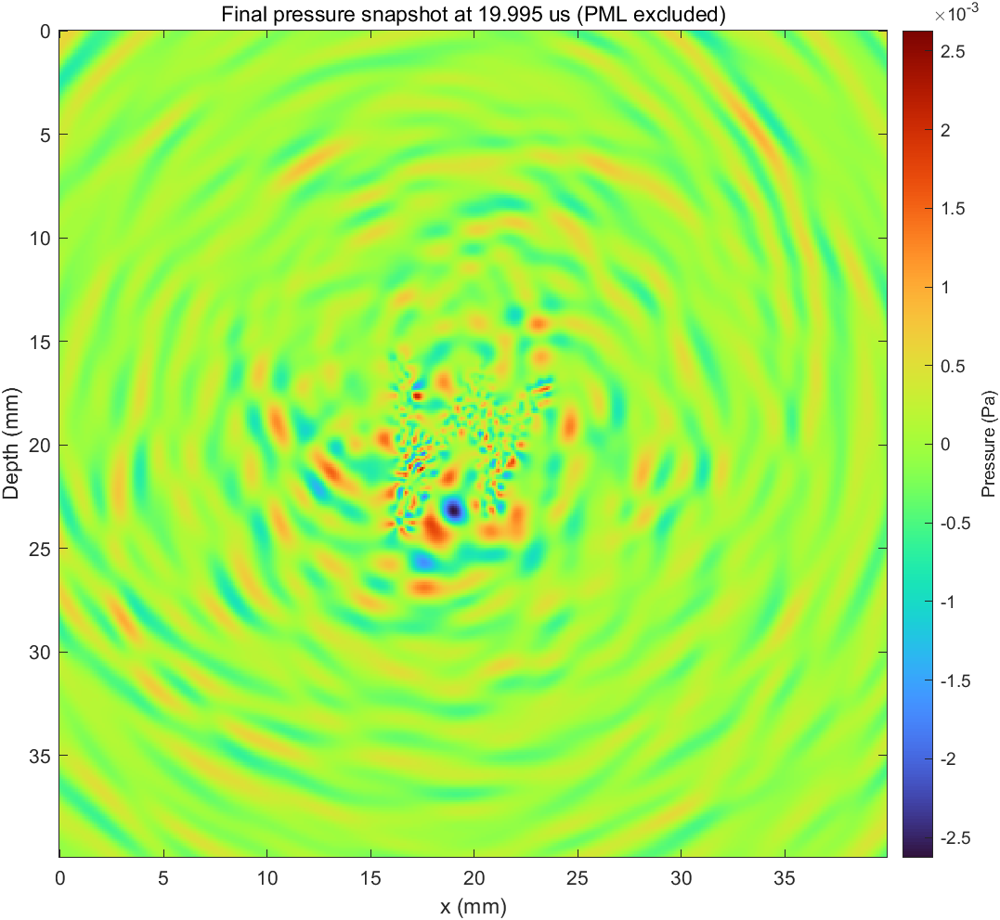

# M0与M1单次发射记录

M0：MATLAB R2024b，安装在既有D:/matlab；项目写入路径为E:/FNO_research。GPU为RTX5070，驱动610.88，约12GB显存。MATLAB原生CUDA库不直接支持计算能力12.0，启用进程内CUDA前向兼容后小FFT与实际k-Wave仿真均运行成功。没有安装CUDA Toolkit。

k-Wave版本1.4.1，工具箱在项目toolboxes目录，仅addpath到当前进程，不写MATLAB全局路径。PML与时间零点等假设见[完整参考报告](kwave_reference.md)。

单次发射基准使用第32阵元，求解时间9.623秒，含启动/保存/绘图约28.36秒。该次保留了p_final、p_max_all和p_min_all，所以不能直接与后续只记录接收信号的完整FMC每炮时间相比较。所有输出有限，末帧峰值为全程峰值的1.13%。PML未做独立定量收敛验证。

该单次参考MAT仍保留在本机results/m1_single_tx_20261019_160322_819/single_tx.mat，并作为本轮64发射的固定模型/波源输入。完整FMC的第32炮与它逐元素相同。

原始M0曾在E盘项目目录无写权限时错误地继续启动MATLAB，已向用户披露并停止；后续获用户设置项目目录权限后，启动器均显式配置E盘临时、首选项和缓存路径。本轮未发生该问题。
