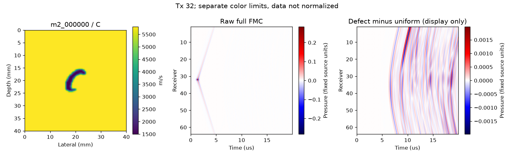
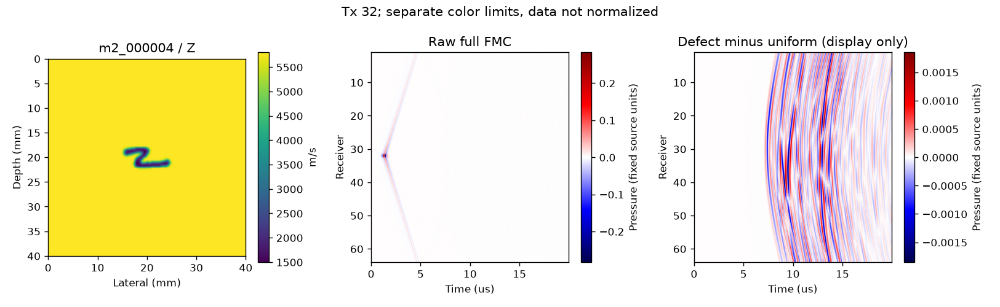

# M2完成：Deepwave 0.05 mm的500样本数据集

生成结束：2026-10-20T01:11:20.626511（Asia/Shanghai）。**500样本与1份同配置均匀FMC已完成，全文件SHA256审计通过；没有开始M3。**

## 数据和划分

位置：`E:/FNO_research/data/m2_emnist500_dw005_v1`。训练375、验证40来自EMNIST letters train；测试85来自letters test。seed=42，只按冻结清单运行；来源索引、原图哈希、200²声速模型哈希均无重复。EMNIST letters将大小写归为同一字母类，图中的小写字形不是标签错误。

| 字母 | 训练 | 验证 | 测试 |
|---|---:|---:|---:|
| A | 14 | 1 | 3 |
| B | 15 | 2 | 3 |
| C | 14 | 1 | 4 |
| D | 15 | 2 | 4 |
| E | 14 | 2 | 4 |
| F | 15 | 2 | 3 |
| G | 15 | 2 | 3 |
| H | 14 | 1 | 3 |
| I | 14 | 2 | 3 |
| J | 15 | 1 | 3 |
| K | 14 | 2 | 3 |
| L | 14 | 1 | 3 |
| M | 15 | 2 | 4 |
| N | 15 | 2 | 4 |
| O | 14 | 1 | 3 |
| P | 15 | 2 | 3 |
| Q | 14 | 1 | 3 |
| R | 14 | 2 | 3 |
| S | 15 | 1 | 3 |
| T | 14 | 1 | 3 |
| U | 15 | 2 | 4 |
| V | 14 | 1 | 3 |
| W | 14 | 1 | 4 |
| X | 14 | 1 | 3 |
| Y | 14 | 2 | 3 |
| Z | 15 | 2 | 3 |

每个HDF5含`c_200`（200×200 float32）及其硬链接`label`、字母编号/名称、来源索引属性、`fmc`（64×64×1000 float32）、20ns输出时间轴和配置/清单指纹。`samples/uniform.h5`是同配置的完整64炮均匀参考，letter_id=0仅表示参考介质。FMC保留完整场和冻结标定，不归一化、不扣均匀场；未保存8000点内部波形。

物理配置保持已确认版本：h=0.05mm、dt=2.5ns、accuracy8、800²、四边外置40点PML=2mm；56字形居中置入200标签，1500–5800m/s映射，标签最近邻重复4×4。点阵元坐标、2.25MHz Ricker及3/f0时间偏移不变；源f=-2h_c/(c_s h²dt)Δr、h_c=0.1mm，冻结增益0.9907679913977262、零时移。

## 实际耗时与体积

- 首个生成会话开始至最后生成完成：**123.57分钟（2.059小时）**，包含前10个检查与图像复核间隔。
- 两个生成会话墙钟之和：123.11分钟；500样本处理时间求和122.71分钟，GPU传播求和121.67分钟。
- 均匀参考处理15.247秒；500样本单个处理时间均值14.725秒，最小/最大13.916/16.202秒。处理时间含传播、保存、同步、读回校验及SHA，记录写入/会话导入另计。
- 500样本HDF5总计8,281,120,000字节；均匀参考16,562,240字节；合计**8.297682 GB（7.7278 GiB）**。不含小型清单/记录/PNG/日志。
- 最后全文件审计耗时26.55秒，另计于生成时间。生成前E盘可用约677.75GB，满足≥20GB；逐样本继续检查空间。

## 质量检查和断点续跑

前10样本及均匀参考有限值、形状、类型、模型范围、幅度检查通过；第一个样本互易相对L2为**3.237732e-06**，低于1e-4。三个正立字形与B扫图已检查，随后自动生成剩余490个。

bulk重启时实际验证并跳过均匀参考与前10个样本，没有重算或覆盖。正式文件先独占临时写入、fsync、内容校验、SHA，随后原子转为正式文件并写完成记录。重启只跳过SHA及内容均通过者；已有损坏正式文件不覆盖。
异常/重试事件数：**0**。全部501个HDF5的SHA256、形状/类型、标签元数据与有限值检查通过。

## 原始FMC幅度统计（没有归一化）

min/max、均值、标准差及RMS来自全部元素的逐样本精确统计汇总；标准差为总体标准差。全量统计仅用于诊断，M3若拟合归一化尺度应只使用训练统计，避免验证/测试泄漏。

| 范围 | min | max | max abs | mean | std | RMS |
|---|---:|---:|---:|---:|---:|---:|
| train | -0.245414421 | 0.282672554 | 0.282672554 | -7.39717741e-09 | 0.0038924069 | 0.0038924069 |
| validation | -0.245414421 | 0.282672554 | 0.282672554 | -8.56530534e-09 | 0.00389209003 | 0.00389209003 |
| test | -0.245414421 | 0.282672554 | 0.282672554 | -5.58787841e-09 | 0.00389215921 | 0.00389215921 |
| all | -0.245414421 | 0.282672554 | 0.282672554 | -7.18304682e-09 | 0.00389233944 | 0.00389233944 |

绝对幅度分位数为确定性分层抽样估计，每1000元素块随机抽1点；不是全量精确分位数。采样种子固定，逐样本索引派生。完整有符号和绝对分位数保存在测量JSON。

| 范围 | 抽样点数 | abs p50 | abs p90 | abs p99 | abs p99.9 |
|---|---:|---:|---:|---:|---:|
| train | 1,536,000 | 5.4868251e-05 | 0.000397323573 | 0.00986037031 | 0.0388947688 |
| validation | 163,840 | 5.57307321e-05 | 0.000388748158 | 0.00993614364 | 0.0392762721 |
| test | 348,160 | 5.49114338e-05 | 0.000389761495 | 0.00969149079 | 0.0397960395 |
| all | 2,048,000 | 5.49440665e-05 | 0.000395310344 | 0.00984247681 | 0.0391765088 |

## 关键图

图中第三列只是从保存数据减去固定均匀参考供显示；没有改写数据或执行M3。原始场与散射场采用各自标注的色标，均保持原数值单位，不作训练归一化。

## 清单与复现

- [冻结划分清单](../configs/m2_split_manifest.json)、[运行配置](../configs/m2_dataset.json)、[执行前协议](m2_protocol.md)。
- [全局统计与审计](../configs/m2_measurements.json)、[逐样本时间/大小/SHA256清单](../configs/m2_file_ledger.json)。
- `code/prepare_m2_manifest.py`只在新数据集准备时运行；已有清单拒绝覆盖。官方测试IDX从已有gzip.zip提取，无下载、无安装。
- `& .\code\run_m2.ps1 -ConfigPath E:\FNO_research\repos\fno_light\repro_lu2026\configs\m2_dataset.json -Stage bulk`可复核已有完成文件并跳过；不得修改冻结配置或清单后混用此目录。
- `code/audit_m2.py CONFIG NEW_OUTPUT_DIR`重新审计；输出目录须是新的。`code/plot_m2_preview.py CONFIG`仅绘图，重运行会覆盖该脚本自己的预览PNG。
- 所有代码、数据、缓存和日志位于E:/FNO_research；大数据、原始EMNIST、环境和日志不入Git。代码/清单/JSON报告/PNG轻量提交。M2到此结束，未进入M3。
