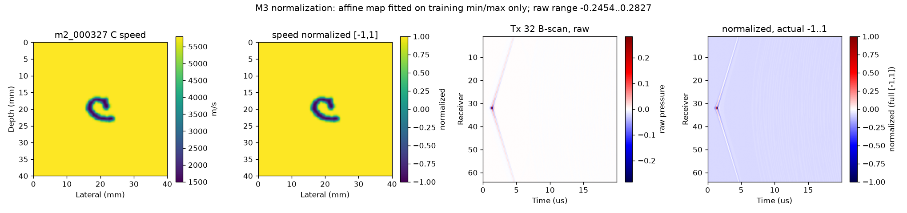
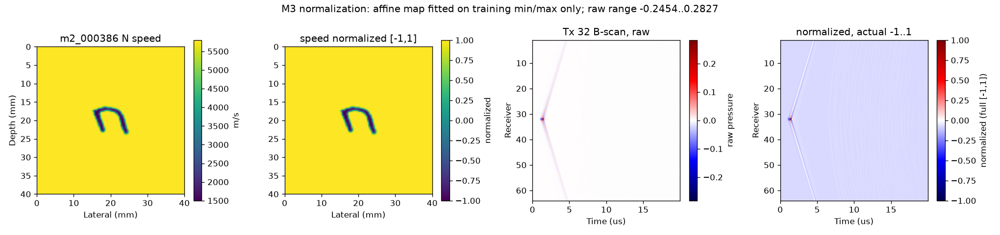
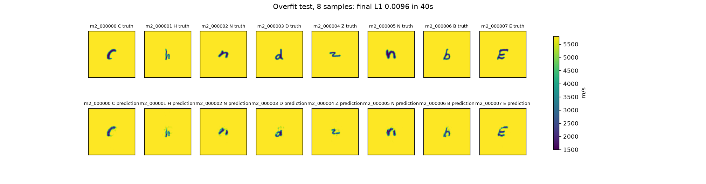
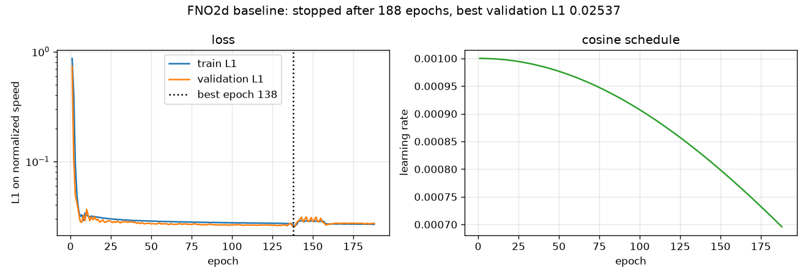
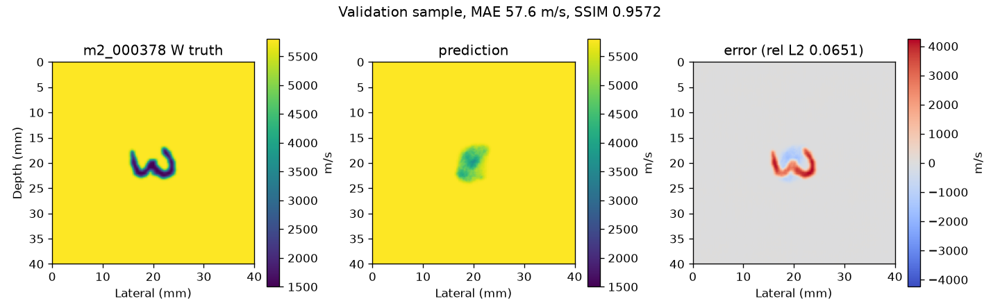
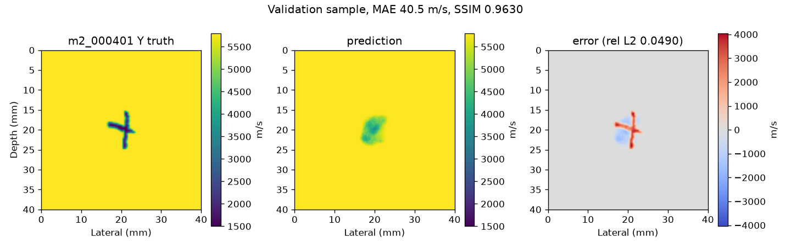
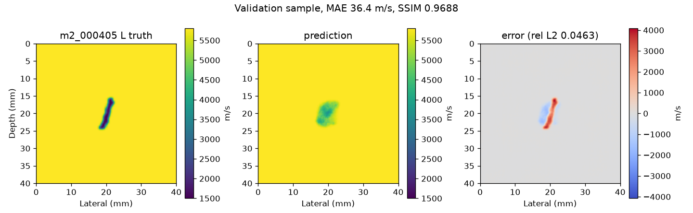

# M3 数据加载 + M4 原版FNO基线

生成环境：Python 3.12.15、PyTorch 2.11.0+cu128、Deepwave 0.0.27、**NVIDIA GeForce RTX 5070（11.94 GB，sm_120，`torch.cuda.is_available()` 为 True）**。所有代码、数据、缓存、日志在 `E:\FNO_research\`，未安装或升级任何软件。

**结论先行：数据加载（M3）与训练管线（M4）完全打通并可复现；但按论文式设置的原版FNO基线没有恢复字母身份——验证集相对L2 0.0626，仅略优于"恒预测背景5800 m/s"（0.0731），且低于"直接输出训练集平均声速图"（0.0559）。这不是训练脚本故障，而是该架构在"直达波主导、逆散射信号极弱"的输入上坍缩到模糊的中心团块；诊断证据、被批准的偏离和仍未解决的问题都写在下面。**

---

## 1. M3：数据加载与归一化

### 1.1 划分

严格读取冻结清单 `configs/m2_split_manifest.json`，不重新划分、不重选样本：训练 375、验证 40、测试 85（共 500，加 1 份均匀参考 = 501 个 HDF5）。加载器同时校验 `manifest_sha256` 与清单指纹，配置与数据不匹配会直接报错。

### 1.2 归一化（参数全部在 JSON 里）

| 项 | 映射 | 参数文件 |
|---|---|---|
| 声速 | 固定物理范围 1500–5800 m/s → [−1,1]，不拟合 | `configs/m3_scatter_normalization.json` |
| 输入（原方案） | 全 FMC 用**训练集**全局 min/max → [−1,1] | `configs/m3_normalization.json` |
| 输入（现用，见第 4 节） | 样本 FMC − 均匀参考，再用**训练集散射场**全局 min/max → [−1,1] | `configs/m3_scatter_normalization.json` |

训练集实测（只由 375 个训练样本拟合，验证/测试不参与）：

| 量 | 值 |
|---|---|
| 全 FMC min / max | −0.245414420962 / 0.282672554255 |
| 全 FMC scale / offset | 3.78725492932 / −0.0705530244841 |
| 全 FMC 拟合耗时 | 5.81 s（1.536×10⁹ 个元素，1008 MiB/s） |
| 散射场 min / max | −0.00590231781825 / 0.00442635593936 |
| 散射场 scale / offset | 193.635702602 / 0.142899457717 |
| 散射场拟合耗时 | 12.64 s（464 MiB/s） |

### 1.3 归一化后的幅度分布

原始 FMC 未归一化存储；下表分别给出原始、按训练集 min/max 归一化后、以及"样本减均匀参考"的散射分量。

| 范围 | 原始FMC RMS | 归一化FMC RMS | 散射RMS | 散射/直达 |
|---|---:|---:|---:|---:|
| train | 0.00389241 | 0.0720767 | 2.07627e-04 | 0.0534175 |
| validation | 0.00389209 | 0.0720764 | 2.01600e-04 | 0.0518670 |
| test | 0.00389216 | 0.0720765 | 2.02930e-04 | 0.0522093 |
| all | 0.00389234 | 0.0720766 | 2.06358e-04 | 0.0530912 |

散射场归一化后 RMS = **0.0402039**（原始 2.07627e-04 × scale 193.64）。

**这张表就是后面一切问题的根源：散射分量只占直达波的 5.3%，归一化后输入 RMS 仅 0.040；500 个样本的 FMC 有 99.3% 是完全相同的直达波。**

### 1.4 可视化

随机 3 个样本（seed=42），每张图从左到右为：声速真值（m/s）、归一化声速、第 32 炮原始 B 扫、**同一道归一化后的 B 扫**。第 3、4 面板即"归一化前后各一张"。






第 4 面板固定用完整 [−1,1] 色标，便于看出数据实际只占很窄的一带（标题给出真实范围）；这不是显示错误。

### 1.5 按需加载

数据 8.3 GB、主机内存 15.6 GB，因此不做全量预载，DataLoader 按需从 HDF5 读取。

| 划分 | 批数 | 首批耗时 | 平均批耗时 | 吞吐 |
|---|---:|---:|---:|---:|
| train | 12 | 9.485 s（含worker启动+冷缓存） | 1.121 s | 27.9 样本/s，436 MiB/s |
| validation | 2 | 6.231 s | 3.115 s | 6.4 样本/s |

首个 epoch 冷缓存约 12–15 s/轮，之后受操作系统页缓存加速；训练实测平均 15.51 s/轮（含验证）。

---

## 2. M4：模型与训练

### 2.1 结构（纯 PyTorch，未用 neuraloperator）

输入 `(64 通道=发射, 1000=T, 64=R)` + 归一化 t、r 两通道 → 逐点线性升到 width=32 → 沿 T 的线性层 1000→200、沿 R 的线性层 64→200 → 4 个 Fourier 层（谱卷积 + 1×1 卷积 + GELU，模态 40×40）→ 两层逐点 MLP（32→128→1）→ 200×200 声速图。没有 U-Net 支路、没有注意力、没有物理损失。

| 模块 | 参数量 |
|---|---:|
| lift (66→32) | 2,144 |
| T resample (1000→200) | 200,200 |
| R resample (64→200) | 13,000 |
| 4× Fourier 层（谱卷积 4×1.638M 复权重 + 1×1） | 26,218,624 |
| project (32→128→1) | 4,353 |
| **合计** | **26,438,321** |

### 2.2 实测开销

| 项 | 值 |
|---|---|
| 单步（batch 32，前向+反向+更新） | 159 ms |
| 每轮步数 | 12 |
| 显存峰值 | 5.30 GiB（batch 32 可直接用，未降到 16） |
| 预训练估算 | 3.9 s/轮×500 ≈ 32.5 min（偏乐观，实际含数据加载 15.5 s/轮） |

### 2.3 正式训练前的门禁

**8 样本过拟合检验**：用现用输入（散射场）训练 8 个训练样本，第 810 步训练 L1 降到 **0.00958**（目标 <0.01），预测图能清楚区分 C/H/N/D/Z/B/E 七个不同字母。



用原方案输入（完整 FMC）时同一门禁**三次尝试均失败**（详见第 4 节），因此按你的批准改用散射输入后重做，通过后才启动正式训练。

### 2.4 训练设置与结果

Adam，lr 1e-3，余弦退火至 1e-5，batch 32，L1 损失（归一化声速），验证集 L1 连续 50 轮不降早停，最多 500 轮，seed=42，TF32 开启。

| 项 | 值 |
|---|---|
| 实际轮数 | **188**（best epoch 138，之后 50 轮未改善而早停） |
| 最佳验证 L1（归一化） | **0.02537** |
| 总训练耗时 | **2915.13 s（48.59 min）**，15.51 s/轮（含验证） |
| 显存峰值 | 5.30 GiB |
| 早停触发 | epoch 188 |



### 2.5 验证集指标（40 个样本，未碰测试集）

| 指标 | 模型 | 恒预测 5800 m/s | 训练集平均声速图 |
|---|---:|---:|---:|
| 相对L2（样本RMS） | **0.06259** | 0.07313 | 0.05591 |
| 相对L2（样本均值） | 0.06151 | 0.07204 | 0.05554 |
| MAE (m/s) | **54.56** | 56.30 | 61.22 |
| RMSE (m/s) | 354.08 | 414.73 | **319.79** |
| SSIM | 0.95724 | **0.96014** | 0.95072 |
| 验证L1（归一化） | **0.02537** | 0.02618 | 0.02847 |

逐样本：相对L2 最小 0.04151、最大 0.08992；SSIM 最小 0.93887、最大 0.96883。

### 2.6 三个验证样本对比







三张图都是"真值 / 预测 / 误差"。预测确实学到了"缺陷在中心、尺寸大致正确"的先验，但**没有恢复字母形状**：真值是 W 时预测是圆团，误差图里字母笔画以 ±4300 m/s 的量级整块出现。SSIM 高达 0.957 只是因为 200×200 里 95% 以上是背景，这个指标在这种图上几乎不敏感——这也解释了为什么"恒背景"的 SSIM(0.960) 反而略高。

**因此这份基线的定位是：管线正确、可复现、指标可对照，但没有完成逆散射任务本身。** 相对L2 0.0626 不能当作"6% 误差"来解读，它主要由背景占比决定。

### 2.7 一次已修正的统计错误

第一次评估把"恒背景"参照算成了 `1 − 声速(m/s)`，与归一化目标混用，输出过 `MAE = 5742 m/s`、`val_l1_normalized = −5742`。已修正为在 m/s 域计算，并用保存的 best 权重重跑评估（不重训），上表是修正后的数值；代码中同一处也已改正。

---

## 3. 与论文设置的偏离（需要单独看待）

**偏离只有一条：输入改为"样本 FMC − 均匀参考 FMC"，再用训练集的散射场全局 min/max 线性映射到 [−1,1]。** 声速归一化、网络结构、模态、损失、优化器、轮数、早停规则全部保持原样。

改动理由分两层。工程上：实际检测中无缺陷试块（或无缺陷区域）的 FMC 是可直接采集的参考，减参考是常规做法。科学上：原方案在本架构下**无法学习**，证据如下（全部为实测，同一 8 样本、同一架构）：

| 输入 | 8 样本最终 L1 | 输出跨样本标准差 | 结论 |
|---|---:|---:|---|
| 全 FMC（训练集 min/max→[−1,1]），800 步 | 0.02363 | 3.3×10⁻⁵ | 塌缩成常数图 |
| 全 FMC，3000 步 + 余弦退火 | 0.02356 | 5.6×10⁻⁵ | 无改善 |
| 全 FMC ×14（RMS≈1，消除幅度因素） | 0.02359 | 5.6×10⁻⁵ | 放大无效 |
| 纯噪声（无信息，RMS=1） | **0.00054** | 3.48×10⁻² | 架构有能力记忆 |
| 散射场 ×1000（RMS≈0.72） | **0.00043** | 3.47×10⁻² | 去掉共模即可学习 |
| 模态 99（全频带） | 0.02357 | 2.4×10⁻⁵ | 不是模态截断 |
| lr 5×10⁻³ / 2×10⁻² | 0.049 / 0.028 | ~0 | 不是学习率 |
| 40 模态低通真值（理论下限） | **0.00232**（MAE 5 m/s） | — | 不是表示能力 |
| 恒背景参照 | 0.02730 | — | — |

机理：500 个 FMC 的直达波完全相同，样本间差异只占输入均值的 **0.7%**。逐层追踪该相对差异（std/mean）为
`0.714% → 0.367%（lift）→ 0.539%（T重采样）→ 0.195%（R重采样）→ 0.077% → 0.024% → 0.0093% → 0.0068%（4 层傅里叶后）→ 0.0016%（输出）`。
相干求和放大了所有样本共有的直达波，非相干的散射差异被逐层压掉，优化停在"平均字母"解。噪声输入之所以能记住，是因为它 100% 是样本间差异、没有共模。

**这个偏离没有完全解决基线问题**：换成散射输入后训练损失能降（门禁通过、训练 L1 从 0.95 降到 0.025），但 375 个样本上的逆映射仍未学会（第 2.5 节）。所以第 4 节列出仍未排除的方向，供你决定是否继续投入。

---

## 4. 仍未解决的问题与下一步建议

按目前设置，基线只能输出"中心模糊团块"。已排除的：数据格式/标签错位（8 样本能完美记忆）、模态截断（全频带一样）、学习率、显存/batch、单位与归一化参数泄漏（验证/测试只用了训练集统计）。

仍可能的原因，按我判断的可能性排序：

1. **T/R 的"稠密全连接"维度映射**：把 1000 个时刻用一层全连接压到 200，会破坏时间局部性——而"到达时刻→深度"本质上是一个平移映射。用局部算子（如 strided conv 或插值+1×1）替代稠密线性层，是当前最容易见效、且仍在"原版FNO"框架内的改动。你原话允许"若你认为有更合理的维度映射方式，写清理由再用"，但我没有再动，因为这会改结构。
2. **输入仍是弱信号**：散射场归一化后 RMS 只有 0.04（峰值才到 ±1），网络需要约 25 倍放大才能匹配 ±1 的输出动态范围。
3. **容量分配**：4 层、width 32、26.4M 参数，在 375 个样本上 188 轮就早停，损失几乎不降，属欠拟合；更长训练或更宽网络可能有用，但会超出 3 小时预算。

这些都需要你先确认，我没有擅自继续。

---

## 5. 复现方式

```powershell
$repo = 'E:\FNO_research\repos\fno_light\repro_lu2026'
$cfg  = "$repo\configs\m3_m4_fno.json"
& "$repo\code\run_m3_m4.ps1" -ConfigPath $cfg -Stage m3-norm-scatter  # 拟合散射场归一化
& "$repo\code\run_m3_m4.ps1" -ConfigPath $cfg -Stage m3-stats         # 幅度分布
& "$repo\code\run_m3_m4.ps1" -ConfigPath $cfg -Stage m3-viz           # 三张预览图
& "$repo\code\run_m3_m4.ps1" -ConfigPath $cfg -Stage m3-load          # 加载基准
& "$repo\code\run_m3_m4.ps1" -ConfigPath $cfg -Stage m4-bench         # 单步/显存/预算
& "$repo\code\run_m3_m4.ps1" -ConfigPath $cfg -Stage m4-overfit       # 8 样本门禁
& "$repo\code\run_m3_m4.ps1" -ConfigPath $cfg -Stage m4-train         # 正式训练
```

`run_m3_m4.ps1` 只在本进程内把 TEMP/TMP/TORCH_HOME/MPLCONFIGDIR/CUDA_CACHE 等重定向到 E 盘，不改全局设置。`m4-train` 每 10 轮写 `last.pt`，配置里 `train.resume=true`、`resume_from="latest"`，中断后直接重跑同一命令即可从断点继续。

产物位置：训练日志/权重/逐轮记录在 `E:\FNO_research\results\m4_train_20261020_111745\`（`best.pt`、`last.pt`、`m4_train_log.jsonl`、`m4_train_summary.json`），轻量 JSON 在 `configs/m3_normalization.json`、`configs/m3_scatter_normalization.json`、`configs/m3_measurements.json`、`configs/m4_measurements.json`。权重、日志、数据不入 Git。

测试集（85 个样本）**本次完全没有读取**，留给 M5。
