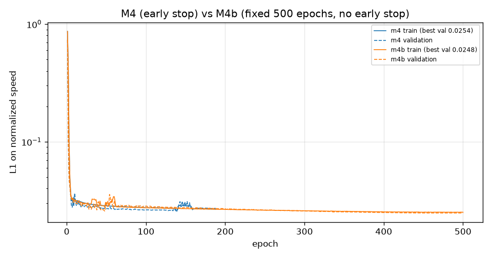
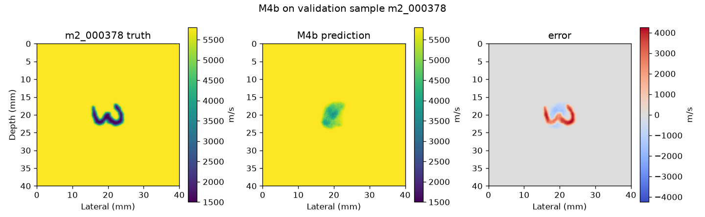
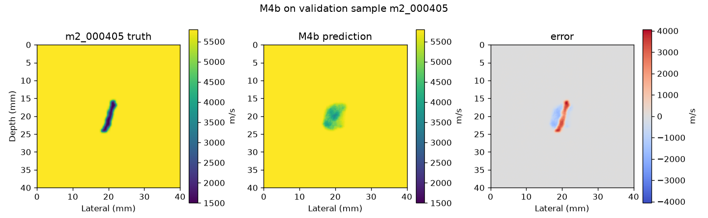
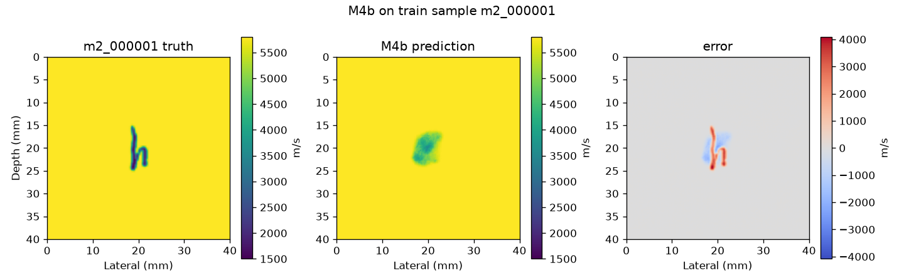
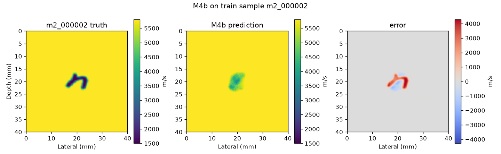

# M4b：训练预算诊断（迭代不足 vs 数据不足）

目的：M4 在 188 轮早停，而论文用 4500 训练样本、60000 次迭代。本轮**只改训练预算**，看模型到底是"没训够"还是"数据/结构不够"。

## 1. 设置（与 M4 的唯一差别）

| 项 | M4 | M4b |
|---|---|---|
| 最大轮数 | 500（早停触发） | **500（无早停，跑满）** |
| 早停 | 验证 L1 连续 50 轮不降 | **关闭** |
| 余弦学习率 | 按 500 轮规划，实际 188 轮中止 | **按完整 500 轮衰减，1e-3 → 1e-6** |
| 权重保存 | best.pt | best.pt + last.pt（每 10 轮 last.pt，可续训） |
| 输入 | 散射场（FMC−均匀参考）+ 训练集 min/max → [−1,1] | 同 |
| 网络 / lr / batch / 损失 / 种子 | 26,438,321 参数 / 1e-3 / 32 / L1 / 42 | **完全相同** |

`configs/m4b_fno.json` 由 `configs/m3_m4_fno.json` 程序化派生，只改上述项；M4 的目录、权重、指标与图**全部保留未动**。

## 2. 训练结果

| 项 | 值 |
|---|---|
| 实际轮数 | **500（全部跑满）** |
| 最佳轮次 | 463 |
| 最佳验证 L1 | **0.02483**（M4：0.02537） |
| 总耗时 | **7670.9 s = 127.8 分钟（2.13 小时）** |
| 平均每轮 | 15.34 s（含验证） |
| 显存峰值 | 5.30 GiB |
| 步数 | 约 6000 步（12 步/轮） |

实测 2.13 小时，低于 3 小时上限，未提前中止。



曲线特征：第 150 轮之后两条曲线几乎重合，M4b 只是把下降拖得更长；最后 25 轮验证 L1 均值 0.024831，前 25 轮 0.024832——**已经饱和**，不是还在明显上升/下降的中途。

## 3. 指标（训练集 375、验证集 40，测试集未读）

三个参照：模型、恒背景 5800 m/s、训练集平均声速图。缺陷区指标以真值 <5000 m/s 为掩膜；Dice/IoU 以 <5000 m/s 二值化。

### 3.1 训练集

| 方案 | 相对L2 | MAE (m/s) | RMSE (m/s) | SSIM | 缺陷区MAE (m/s) | Dice | IoU |
|---|---:|---:|---:|---:|---:|---:|---:|
| M4（早停 188 轮） | 0.06375 | 55.48 | 360.94 | 0.9579 | 2251 | 0.4667 | 0.3119 |
| **M4b（跑满 500 轮）** | 0.06327 | 54.21 | 358.25 | 0.9578 | **2208** | **0.4798** | **0.3231** |
| 恒背景 5800 | 0.07507 | 58.22 | 426.10 | 0.9597 | 2883 | 0.0000 | 0.0000 |
| 训练集平均图 | **0.05657** | 61.81 | **323.74** | 0.9514 | **1622** | **0.5935** | **0.4298** |

### 3.2 验证集

| 方案 | 相对L2 | MAE (m/s) | RMSE (m/s) | SSIM | 缺陷区MAE (m/s) | Dice | IoU |
|---|---:|---:|---:|---:|---:|---:|---:|
| M4（早停 188 轮） | 0.06259 | 54.56 | 354.08 | 0.9572 | 2218 | 0.4409 | 0.2892 |
| **M4b（跑满 500 轮）** | 0.06219 | 53.38 | 351.95 | 0.9571 | **2177** | **0.4555** | **0.3014** |
| 恒背景 5800 | 0.07313 | 56.30 | 414.73 | 0.9592 | 2833 | 0.0000 | 0.0000 |
| 训练集平均图 | **0.05591** | 61.22 | **319.79** | 0.9507 | **1583** | **0.5838** | **0.4203** |

缺陷像素数（每样本平均）：真值 764（训练）/750（验证）；M4b 预测 578；训练集平均图预测 1388（明显过量）。

### 3.3 样本图（M4b 预测；验证样本与 M4 报告相同）

验证集：






训练集（模型在它**见过**的样本上的表现，是判定"数据不足 vs 优化问题"的关键）：






训练集样本上同样是"中心团块"，笔画没有被还原——这就是判为优化/结构问题的直接依据。

## 4. 判定

按你给的三条规则：

- **规则一（数据不足）不成立**：它要求训练集 Dice 明显 >0.7 而验证集仍低。实测训练集 Dice 只有 **0.4798**，没有达到 0.7。
- **规则三（验证集明显改善）不成立**：验证集相对L2 从 0.06259 到 0.06219、Dice 从 0.4409 到 0.4555，属于微小改善；损失曲线最后 50 轮已饱和。
- **规则二成立：训练集也学不出字母，判为优化/结构问题。**

支撑证据：

1. **模型在它见过的数据上就失败**。训练集 Dice 0.4798、缺陷区 MAE 2208 m/s——对字母内部像素平均错约 2.2 km/s（真值 1500 m/s，预测仍接近背景 5800 m/s）。
2. **训练/验证差距极小**（Dice 差 0.024，L1 差 0.0003），说明不是过拟合，也不是"数据不够泛化"，而是根本没拟合。
3. **加 2.66 倍预算只换来 +0.013（训练）/ +0.015（验证）Dice**。按这个斜率，论文规模（60000 步，约我们的 10 倍）在同样架构下估计需要 **约 21.3 小时**（127.8 min × 10），且大概率仍不够。
4. **模型还不如一个不学习的参照**：训练集平均图（把 375 张声速图逐像素取平均）在训练集和验证集上的 Dice（0.5935 / 0.5838）与缺陷区 MAE（1622 / 1583）都优于两个模型。也就是说，模型目前连"固定输出平均字母"都没达到。
5. **架构本身有容量**：M4 的 8 样本门禁能把 L1 压到 0.0096 并复原不同字母，说明不是表示能力不足，而是 375 个样本时优化停在了低容量解。

结论：**在 375 个样本、当前结构下，继续加迭代不是有效方向；瓶颈在优化/结构，不在数据量。** 因此我没有执行"扩充到 2500 样本"（那是规则一的动作）。

## 5. 建议（未实施）

按规则二，可以提出局部 T 轴映射方案，但本轮不实施：

- **问题**：现在用时域稠密全连接 `Linear(1000→200)` 把 1000 个时刻压成 200 个"深度"位置。这个矩阵每个输出都是全部 1000 个时刻的线性组合，破坏了时间局部性；而"直达波到达时刻 → 深度"本质是一个局部的平移/伸缩关系。
- **候选改法**：沿 T 轴改为局部算子，例如 `Conv1d(kernel=8, stride=5)`（1000→200）或先按窗口池化再用 1×1 卷积，R 轴同理（`Conv1d(kernel=4, stride=4)` 或插值 + 1×1）。参数量会大幅下降（当前这层 200,200 参数里绝大多数是"全局混叠"），且保留局部时序结构。
- **预期**：让每个深度位置的输入只来自其对应的一小段到达时刻，梯度更容易把"到达时间差"与"缺陷深度"联系起来。
- **风险**：这会改结构，超出"原版FNO"的严格定义；是否实施需要你确认。

另外两个不涉及结构的方向（供参考，未做）：把散射场输入再按样本标准化（当前归一化后 RMS 仅 0.040）；或先用更小的 64×64 输出分辨率验证管线（200×200 的稀疏笔画对 L1 不友好）。

## 6. 规矩执行情况

- 测试集（85 样本）**未读取、未评估**；未开始 M5。
- 所有新增文件在 `E:\FNO_research\`；M4b 结果写入新目录 `results/m4b_train_20261020_132524`，未覆盖 M4 的任何产物。
- 未安装/升级任何软件，未改全局配置与代理设置。
- 权重、日志、数据不入 Git；本次只提交代码/配置/报告/图。

## 7. 复现

```powershell
$repo = 'E:\FNO_research\repos\fno_light\repro_lu2026'
$cfg  = "$repo\configs\m4b_fno.json"
& "$repo\code\run_m3_m4.ps1" -ConfigPath $cfg -Stage m4-train        # 500 轮，无早停，可断点续训
& "$root\envs\deepwave\Scripts\python.exe" "$repo\code\m4b_diagnostics.py" `
    "E:\FNO_research\results\m4_train_20261020_111745" `
    "E:\FNO_research\results\m4b_train_20261020_132524"               # 只读权重，不重训
```

诊断脚本只用已保存的 `best.pt` 重算指标并出图，不改动任何训练产物。
