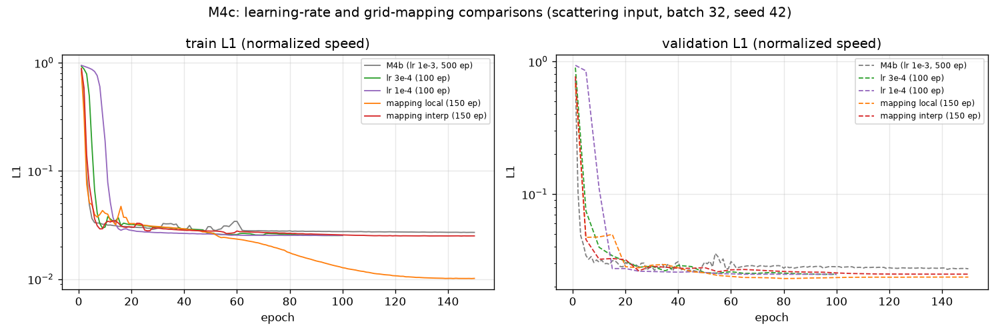
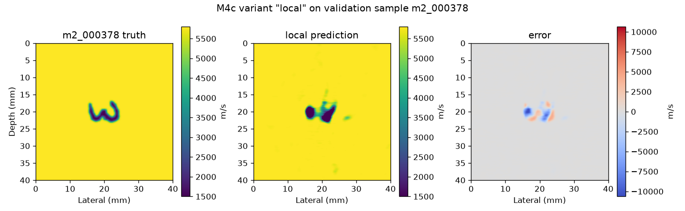
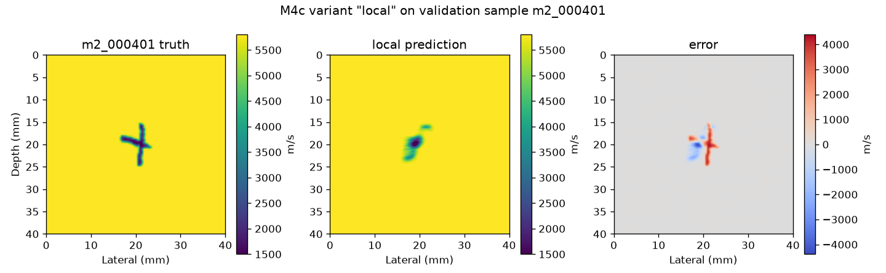
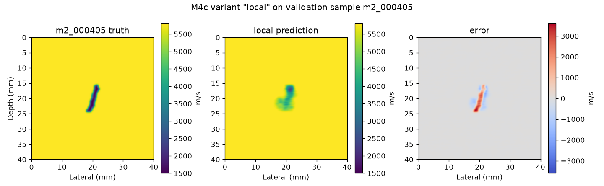
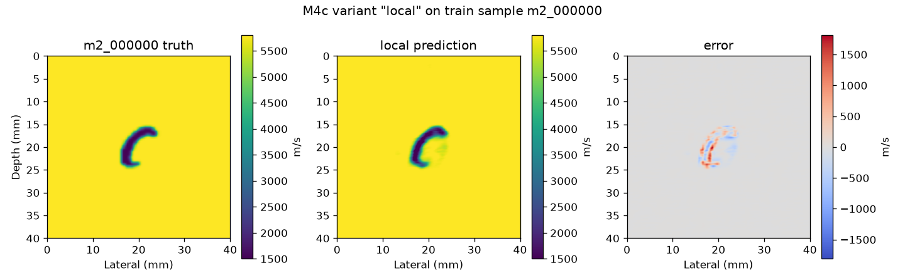
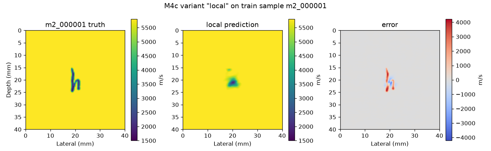
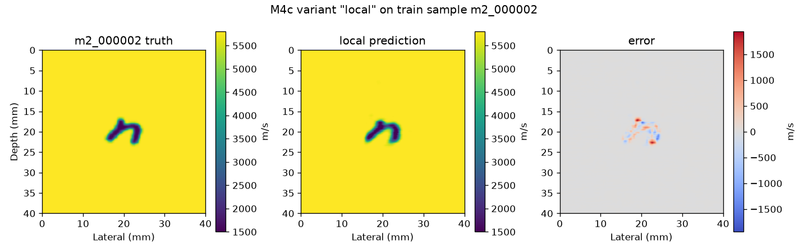

# M4c：先排便宜疑点，再做 T/R 映射层消融

预算约束 ≤3 小时；实际 15:47–18:20，约 **2.55 小时**（含两次外部中断后的续跑）。所有实验统一用 M4b 输入（散射场 = FMC − 均匀参考，训练集 min/max → [−1,1]）、L1、batch 32、seed 42；指标同 M4b（相对L2/MAE/RMSE/SSIM + 缺陷区 MAE/Dice/IoU），训练集与验证集都报，并列训练集均值图参照。**测试集全程未读取。**

结论速览：**问题主要出在 T/R 映射层（结构），不是学习率。** 把时域稠密全连接 `Linear(1000→200)` 换成局部卷积后，150 轮内训练集 Dice 从 0.48 跳到 **0.835**、缺陷区 MAE 从 2208 降到 **21.8 m/s**，字母被真正重建；验证集 Dice 同时升到 0.581。而在此之前，模型实际上是一个几乎常数的函数。

---

## 1. 输入敏感性（用 M4b best.pt，不训练）

| 数据 | 预测跨样本标准差 | 真值跨样本标准差 | 比值 | 与训练集均值图的空间相关 | L1（真配对） | L1（打乱配对） | ΔL1 |
|---|---:|---:|---:|---:|---:|---:|---:|
| 训练集 375 | 0.0973 m/s | 74.12 m/s | **0.00131** | 0.8575 | 0.025213 | 0.025218 | +6×10⁻⁶ |
| 验证集 40 | 0.0856 m/s | 72.13 m/s | **0.00119** | 0.8575 | 0.024828 | 0.024830 | +2×10⁻⁶ |

**结论：M4b 模型基本忽略输入——预测只随样本变化 0.1 m/s（真值 72–74 m/s），把输入与目标随机打乱后损失几乎不变（2–6×10⁻⁶），输出与训练集均值图相关 0.86。所以 M4/M4b 的"预测"本质是一张固定图，M4b 的全部指标都来自这个常数先验。**

## 2. 子集记忆曲线（lr 1e-3 恒定，各 1500 步）

| N | 该子集训练 L1 | Dice | IoU | 缺陷区 MAE (m/s) | 耗时 |
|---|---:|---:|---:|---:|---:|
| 8 | 0.00269 | **0.9969** | 0.9937 | 48.8 | 63 s |
| 32 | 0.00574 | **0.9589** | 0.9222 | 302.7 | 229 s |
| 128 | 0.02985 | 0.4035 | 0.2577 | 2332.6 | 686 s |
| 375 | 0.02911 | 0.4803 | 0.3230 | 2181.2 | 874 s |

**结论：记忆能力在 N=32 与 N=128 之间断掉（0.959 → 0.404）。26M 参数不缺容量，但从 128 开始优化就停在"常数先验"解上。**

## 3. 低学习率（全 375 样本，100 轮，余弦按 100 轮）

| 学习率 | 训练 Dice | 验证 Dice | 训练 MAE | 验证 MAE | 训练 L1@50 | 验证 L1@50 | 训练 L1@100 | 验证 L1@100 |
|---|---:|---:|---:|---:|---:|---:|---:|---:|
| 1e-3（M4b 同配置） | 0.4798* | 0.4555* | 54.21* | 53.38* | 0.03051 | 0.03068 | 0.02752 | 0.02833 |
| 3e-4 | 0.4723 | 0.4483 | 54.37 | 53.50 | 0.02664 | 0.02559 | 0.02531 | 0.02489 |
| 1e-4 | 0.4621 | 0.4368 | 54.47 | 53.54 | 0.02609 | 0.02570 | 0.02536 | 0.02490 |

\* 1e-3 一行为 M4b 跑满 500 轮的最终指标；其 @100/@150 的 L1 取自 M4b 日志。

**结论：降低学习率让前 100 轮的 L1 降得更快（0.0253 vs 0.0275），但训练 Dice 仍只有 0.47，远低于训练集均值图的 0.5935。按预定规则（需 >0.59 才跑完整 500 轮），两个低学习率都不触发分支一，直接进入第三部分。**

## 4. T/R 映射层消融（150 轮，lr=1e-3，其余不动）

| 变体 | 映射实现 | 参数量 | 训练 Dice | 验证 Dice | 训练 MAE | 验证 MAE | 耗时 |
|---|---|---:|---:|---:|---:|---:|---:|
| dense（M4b 基线） | T/R 各一层稠密 `Linear` | 26,438,321 | 0.4798* | 0.4555* | 54.21* | 53.38* | — |
| **A. local** | T：`Conv2d(kernel(8,1), stride(5,1), padding(2,0))` 使 1000→200；R：双线性插值 64→200 + 可学习 `Conv2d(kernel(1,3))` | 26,236,449 | **0.8352** | **0.5814** | **21.77** | **50.99** | 2004 s |
| B. interp | T、R 都用双线性插值到 200，无可学习映射 | 26,225,121 | 0.4961 | 0.4709 | 53.90 | 53.65 | 1977 s |
| 参照：训练集均值图 | 无学习 | — | 0.5935 | 0.5838 | 61.81 | 61.22 |

\* dense 一行为 M4b 跑满 500 轮的最终指标；同预算（150 轮）下 M4b 的训练/验证 L1 是 0.02703/0.02738，明显差于 local 的 0.01016/0.02372。

实现细节：
- **local 的 T 轴**：卷积核沿时间 8 点、步长 5、两侧各补 2 点，输出长度 `floor((1000+4−8)/5)+1 = 200`，正好等于目标宽度；每个通道独立卷积，因此每个"深度"位置只看到约 8 个相邻到达时刻，而不是全部 1000 个。
- **local 的 R 轴**：先把 64 道线性插值到 200，再用 1×3 的可学习卷积做局部修正。
- **interp**：两个轴都用 `F.interpolate`（bilinear），完全没有可学习参数。

**结论：local 明显优于 interp 和 dense。** 训练集 Dice 0.8352（>0.7 门槛）、缺陷区 MAE 21.8 m/s（约 1.4% 的 4300 m/s 动态范围），说明网络现在真的能从散射场恢复字母；interp 与 dense 同属"学不到"（0.496/0.480），说明 **可学习的局部映射是关键，而不是"能不能重采样"本身**。



## 5. 最好变体（local）的样本图

验证集（与 M4b 同样本）：







训练集：







训练样本上字母 C 已清晰重建，误差集中在笔画边缘 ±500–1500 m/s（dense 时是整块 ±4300 m/s）。

## 6. 总判定

一句话：**问题主要在映射层（结构），学习率不是主因。** 稠密 `Linear(1000→200)` 把 1000 个到达时刻做全局线性混叠，网络因此只能收敛到"常数先验"（第 1 节证明它几乎忽略输入）；换成局部卷积后同一预算内训练 Dice 0.48→0.835。

数据量现在才成为次要瓶颈：local 的训练/验证 Dice 差距 0.25（0.835 vs 0.581），验证集仍低于训练集均值图之上的水平，说明 375 个样本对"泛化"确实不够，但这是**在能拟合之后**才出现的问题，与 M4b 当时"训练集都学不出"的性质不同。

下一最可能的原因（按要求只提不实施）：**验证集泛化差距 → 训练样本量/多样性不足**；其次是 150 轮对"泛化"仍偏短（训练 L1 仍在下降而验证已饱和，是典型的数据受限）。若要继续，优先级应是先扩样本，而不是继续调结构或调 lr。

## 7. 规矩执行

- 测试集未读取、未评估；未开始 M5；未扩充数据。
- 所有新文件在 `E:\FNO_research\`；结果写入新的时间戳目录（`m4c_local_20261020_170451`、`m4c_interp_20261020_173819`），未覆盖 M4/M4b 任何产物。
- 未安装/升级软件，未改全局配置。
- 权重、日志、数据不入 Git。

## 8. 复现

```powershell
$repo = 'E:\FNO_research\repos\fno_light\repro_lu2026'
$py   = 'E:\FNO_research\envs\deepwave\Scripts\python.exe'
& $py "$repo\code\m4c_part1.py" sens      # 输入敏感性（用 M4b 权重，不训练）
& $py "$repo\code\m4c_part1.py" subset    # N=8/32/128/375，各 1500 步
& $py "$repo\code\m4c_part1.py" lowlr     # lr 3e-4 / 1e-4，各 100 轮
& $py "$repo\code\m4c_ablation.py" run local 0.001
& $py "$repo\code\m4c_ablation.py" run interp 0.001
& $py "$repo\code\m4c_ablation.py" figs local
& $py "$repo\code\m4c_curves.py"
```
