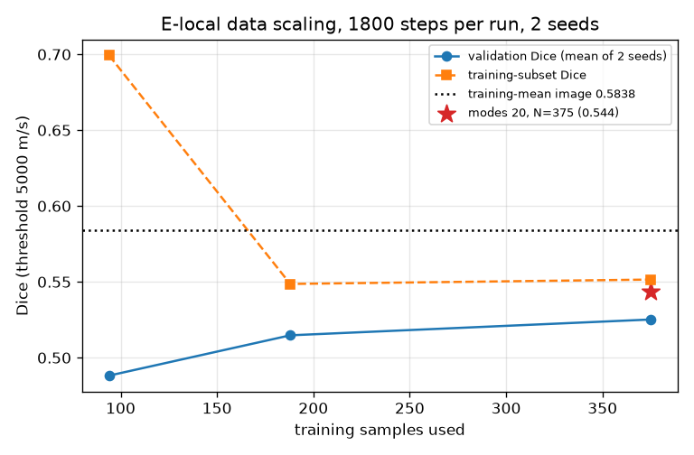

# M4d-E：输入依赖、指标口径、数据缩放与容量对照（第一、二段）

模型一律为 M4c 的 **local** 映射变体（lr 1e-3，其余同 M4c）。本文件中的实验前缀 **E** 指"改进 FNO 线"，**它不是 Lu 2026 U-FNO 的严格复现**：U-FNO 声称的改进（U-Fourier 支路等）一个也没实现，E 线只是把 T/R 网格映射换成局部算子后的普通 FNO。所有结论只针对验证集与训练集，**测试集封存**。

---

## 1. 输入依赖性（置换为主检验）

固定种子 7 生成**单个无不动点置换**：验证样本 i 的输入换成样本 j 的散射 FMC。对每个 i 同时计算"输出与标签 i 的 Dice"和"输出与标签 j 的 Dice"。

| 数据 | 正常输入 Dice | 置换后 vs 标签 i | 置换后 vs 自己标签 j | 下降（均值/中位） | Dice_j > Dice_i 比例 | 与均值图平均差异 |
|---|---:|---:|---:|---:|---:|---:|
| 训练 375 | 0.8352 | 0.4352 | 0.8352 | 0.4000 / 0.3972 | **100%** | 54.5 m/s |
| 验证 40 | 0.5814 | 0.4220 | 0.5814 | 0.1594 / 0.1400 | **90.0%** | 52.2 m/s |

**结论：模型确实依赖输入**（置换后验证 Dice 降 0.159 ≥ 0.05，且 90% 的样本匹配自己的标签更好）——这一点与 M4/M4b 的"常数图"有本质区别。

全零输入（分布外，训练集中没有无缺陷样本，**只作描述、不用于判定**）：

| 量 | 值 |
|---|---|
| 输出均值 | 5786.8 m/s（接近理想 5800） |
| 跨样本 std | 0.0 m/s |
| 与训练集均值图平均差异 | 46.1 m/s |
| 预测 <5000 m/s 的像素比例 | 0.66% |

## 2. 指标口径核查

M4c 报告曾写"缺陷区 MAE 21.8 m/s"，**这是错的**：21.77 是全图整体 MAE，缺陷区内（真值 <5000 m/s）实际是 869.5（训练）/1919.4（验证）。M4c 报告已加更正节。

| 数据 | 整体 MAE | 缺陷区 MAE | Dice | IoU | 相对L2 |
|---|---:|---:|---:|---:|---:|
| 训练 375 | 21.77 | **869.5** | 0.8352 | 0.7310 | 0.03066 |
| 验证 40 | 50.99 | **1919.4** | 0.5814 | 0.4203 | 0.06218 |

均值图参照只用训练标签（375 张），Dice 阈值固定 5000 m/s。

**阈值扫描（仅诊断，不改默认阈值）**：

| 阈值 (m/s) | 模型 Dice | 均值图 Dice |
|---|---:|---:|
| 3000 | 0.311 | 0.000 |
| 4000 | 0.437 | 0.231 |
| 5000 | **0.581** | **0.584** |
| 5500 | 0.660 | 0.615 |

**结论：模型在严格阈值（3000/4000）上明显优于均值图，在默认 5000 上与均值图持平，在 5500 上反超**——说明它预测的缺陷"偏硬/偏小"，而不是完全没学到。

预测声速直方图见 `m4d_E_pred_hist.png`。

## 3. Dice 分布与逐样本提升

| 量 | 值 |
|---|---|
| 验证 Dice 均值 / 中位 / 标准差 | 0.5814 / 0.5765 / 0.1247 |
| 最小 / 最大 | 0.2129 / 0.8135 |
| 相对均值图的逐样本 Dice 提升（均值） | **−0.0025** |
| 同上（中位数） | −0.0176 |
| 提升为正的样本比例 | **47.5%** |

**结论：整体上与均值图打平（略负），说明"平均形状"仍是很强的先验；但提升在样本间分布很宽，接近一半样本优于均值图。**

## 4. 数据缩放曲线（1800 步/次，种子 0 与 1）

| 训练样本数 N | 验证 Dice（两种子均值） | 种子差 | 训练 Dice | 验证缺陷区 MAE | 全图 MAE |
|---|---:|---:|---:|---:|---:|
| 94 | 0.4882 | 0.0156 | 0.6993 | 2078 | 52.8 |
| 188 | 0.5148 | 0.0113 | 0.5486 | 1974 | 51.1 |
| 375 | 0.5252 | 0.0258 | 0.5515 | 1933 | 50.1 |
| 375（modes 20×20） | **0.5436** | 0.0151 | 0.5801 | 1894 | 49.0 |

**结论：验证 Dice 随 N 单调上升，但 N=375 比 N=188 只高 0.0104（门槛 0.03），且 modes 20 反而比 modes 40 更好 0.018。**

## 5. 第二段判定：不扩数据

门槛为（a）模型依赖输入 且（b）验证 Dice 单调上升、N=375−N=188 ≥0.03。

- （a）**满足**：置换后下降 0.159，90% 样本匹配自己标签。
- （b）**不满足**：两种子均值差 **0.0104 < 0.03**；且容量对照（modes 20）更好，说明当前瓶颈不是样本数。

**因此不生成新数据。** 同时注意：N=94→375 训练 Dice 反而从 0.699 降到 0.552，说明固定 1800 步时样本越多越难拟合——"加数据"在没有更多迭代/容量的前提下不会自动改善验证指标。

## 6. 规矩

测试集未读取、未评估；未开始 M5；未生成新数据；结果写入新的时间戳目录；未覆盖 M4/M4b/M4c 任何产物。代码：`code/m4d_E_inputdep.py`、`code/m4d_E_diagnostics.py`、`code/m4d_E_scaling.py`；数据：`configs/m4d_E_inputdep.json`、`m4d_E_diagnostics.json`、`m4d_E_scaling.json`。
