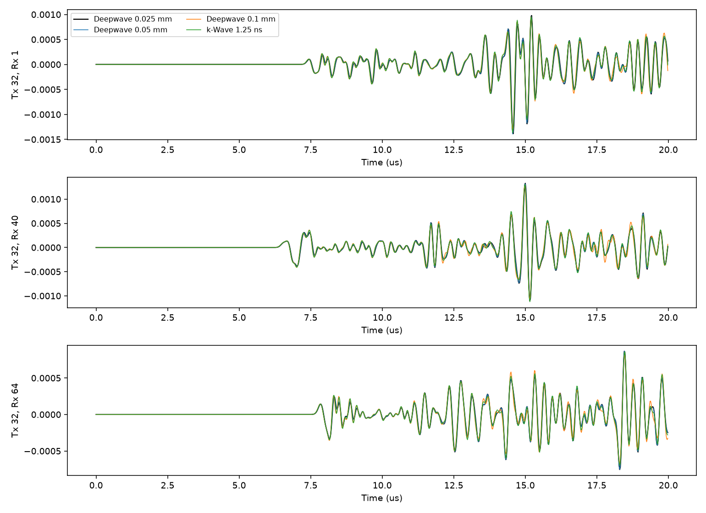

# M2前确认：参考收敛与0.05 mm完整64炮吞吐

2026-10-19。**按预定判据，确认Deepwave h=0.05 mm、dt=2.5 ns、补偿点源总强度的方案可作为本阶段训练集正演方案。** 第32炮相对0.025 mm参考的非对角散射L2为0.090687≤0.10；完整64炮一次批处理成功，含保存的单样本实测14.8619秒。仅完成确认，没有开始M2。

## 参考解收敛

同一200×200标签最近邻重复8×8到1600×1600，h=0.025 mm、dt=1.25 ns、16000步、accuracy=8、四边80点PML=2 mm，阵元物理坐标不变。只运行第32炮的缺陷和全5800 m/s均匀模型，不增加其他模型或发射。每16点抽取到20 ns、1000点，比较完整0–19.98 μs散射场。

源为 `f[n]=-2 h_c/(c_s h_f² dt_f) × (r[n+1]-r[n])`，h_c=0.1 mm，h_f=0.025 mm。相对仅代入h的旧公式，几何补偿因子为4，使源密度空间积分 `f h²` 保持原粗网格物理总强度。Ricker仍2.25 MHz、峰延迟3/f0=1.333333 μs；冻结增益0.9907679913977262、零时移不变，没有拟合。

排除第32接收自收道，共63道；L2分母为0.025 mm散射场范数。相关为零lag Pearson；旧0.05/0.1 mm及k-Wave数据直接复用。

| 相对0.025 mm参考 | 散射相对L2 | 全局相关 | 逐道相关均值 |
|---|---:|---:|---:|
| Deepwave 0.05 mm | 0.090687 | 0.995894 | 0.996116 |
| Deepwave 0.1 mm | 0.276214 | 0.962143 | 0.963484 |
| k-Wave 1.25 ns | 0.177571 | 0.984584 | 0.985472 |

0.05 mm通过≤0.10门槛，因此进入完整64炮吞吐确认。此结论按用户预定规则成立；证据限于这个模型、第32炮和当前频带，不等于证明所有模型都达到9.07%或0.025 mm已是精确真解。上轮k-Wave对0.05 mm的误差较小，本轮对更细参考为0.177571，说明裁判自身误差确实会影响数值排序，不应将任一离散解当作绝对真值。

0.025 mm单炮传播及回传：均匀1.319118秒、缺陷1.207375秒；Torch分配峰值约121.86 MiB，整卡轮询峰值1934 MiB，无OOM。完整检查进程含导入/保存/绘图5.1516秒。通过后没有继续扩大0.025 mm计算规模。

## 完整0.05 mm的64炮实测

同一缺陷模型，800×800、2.5 ns、8000步、40点PML、补偿因子2，冻结增益和零时移不变。**一次批次64炮成功，实际批数1，无OOM，不需拆批。** 保存的是含直接场的完整FMC，而非仅散射；训练阶段是否扣除固定均匀响应未在本轮改变。

| 项目 | 实测 |
|---|---:|
| GPU传播CUDA事件区间 | 14.701700秒 |
| 输出抽取、回传及冻结增益应用 | 0.020195秒 |
| 传播准备及回传墙钟 | 14.799711秒 |
| HDF5保存、关闭及fsync | 0.035928秒 |
| 单样本加载/准备/传播/保存总耗时 | **14.861894秒** |
| 整个成功进程（含导入、预检、保存后校验） | 16.839740秒 |
| Torch峰值分配 | 1,756,991,488字节（约1.636 GiB） |
| Torch峰值保留 | 1,782,579,200字节（约1.660 GiB） |
| 整卡显存轮询峰值 | **3493 MiB（约3.411 GiB）** |
| FMC数组 | 64×64×1000，float32，16,384,000字节（15.625 MiB） |
| 实际HDF5文件 | **16,592,192字节（约16.59 MB）** |

整卡数值包含其他进程，0.5秒轮询可能漏过瞬时峰值；Torch分配峰值是本进程分配器统计。单样本总计从读取模型开始到保存、关闭和同步结束，含一个很小的传播计时检查点写入；不含解释器/库导入、输入哈希预检和保存后校验。GPU事件区间与墙钟口径分别披露，不把二者混为同一指标。

HDF5未压缩，除FMC外还保存200² float32标签、输出时间轴、源子波和配置/标定属性；不保存64炮的全部8000点内部记录。文件SHA256在测量JSON中。保存后逐元素读回检查通过；与既有第1/32/64炮加密缺陷结果相比，相对L2=2.7096e-8，符合float32保存舍入量级。

首次测量的GPU传播和HDF5关闭成功，但最后fsync使用只读句柄，在Windows报`OSError: [Errno 9] Bad file descriptor`。保留该次文件和日志；改为对本次保存文件使用r+b同步，并在保存前持久化计时检查点，第二次完整测量成功。第一次进程耗时16.849325秒，第二次16.839740秒；失败尝试成本单列，不计入每个未来样本的预算。没有隐藏重算，也没有第三次测量或源/参数调整。见[恢复记录](../configs/pre_m2_recovery.json)。

## 更新300/500样本预算

采用本次含保存的14.861894秒/样本，逐样本64炮一次批处理；预算加20%明确工程余量。数据量按实际HDF5文件大小线性外推。

| 样本数 | 单样本总时间线性外推 | 含20%余量 | 磁盘估算 |
|---|---:|---:|---:|
| 300 | 74.31分钟 | **89.17分钟（1.49小时）** | 4.978 GB |
| 500 | 123.85分钟 | **148.62分钟（2.48小时）** | 8.296 GB |

这些数值替代上轮三炮外推的50.9/84.8分钟。一次64炮与22个三炮批次的吞吐不能假设线性相同；本次只测用户要求的最少批次数，没有搜索最快批大小，不对差异作未经测试的性能归因。当前仍只有一个模型、一次成功测量；实际批量中的温度、时钟、I/O和模型准备变化尚未实测，20%余量不是保证。预算不含FNO训练，也不含额外存储内部波形。若每样本重新启动Python，则应另计导入和预检成本；这里的预计批量方式是环境常驻逐样本运行。

## 20个k-Wave跨求解器测试样本：只估算

复用上轮dt=1.25 ns缺陷三炮solver总耗时48.6720038秒，平均每炮16.2240秒。单样本64炮外推约1038.34秒（17.31分钟）：

- 20样本传播约**5.77小时**。
- 加20%余量约**6.92小时**。

这是单进程solver时间外推，不含实际模型准备、启动、保存的专项测量；未假定多进程加速，也未运行20样本。固定均匀背景可一次生成供散射分析复用，无须为每个缺陷模型重复计算。

## 决策、复现与边界

收敛判据通过、完整64炮可运行，确认本阶段候选训练正演配置为Deepwave 0.05 mm / 2.5 ns / accuracy8 / PML40点 / 固定物理总源强。M2尚未启动，等待后续指令。

- [执行前协议](pre_m2_protocol.md)、[收敛配置](../configs/pre_m2_confirmation.json)、[吞吐配置](../configs/pre_m2_throughput.json)。
- [收敛测量](../configs/pre_m2_convergence_measurements.json)、[吞吐测量](../configs/pre_m2_throughput_measurements.json)。收敛测量JSON在吞吐前保存，`throughput_executed=false`仅表示该脚本没有跑吞吐；本报告结合后续独立吞吐结果。
- 运行收敛：`& .\code\run_pre_m2_convergence.ps1 -ConfigPath E:\FNO_research\repos\fno_light\repro_lu2026\configs\pre_m2_confirmation.json`。
- 运行吞吐：`& .\code\run_pre_m2_throughput.ps1 -ConfigPath E:\FNO_research\repos\fno_light\repro_lu2026\configs\pre_m2_throughput.json`；配置中的convergence_run必须指向已通过的检查。脚本不安装软件，每次新建唯一运行目录，不覆盖旧结果。
- 数据目录：`E:/FNO_research/results/pre_m2_convergence_20261019_191957_723/`与`E:/FNO_research/results/pre_m2_throughput_20261019_192118_424/`；首次失败结果也保留，见恢复JSON。日志在项目logs目录，均不入Git。
- 独立平方能量公式复算三项非对角L2一致；检查标签重复、源采样、有限值、HDF5形状/类型/读回、旧三炮一致性和关键图。所有新增文件在E:/FNO_research，没有安装或写入C盘。
