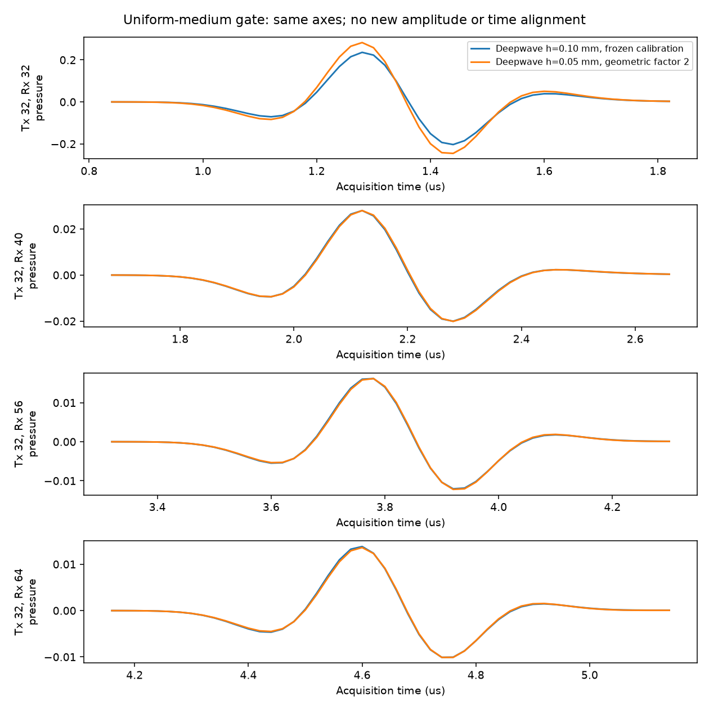
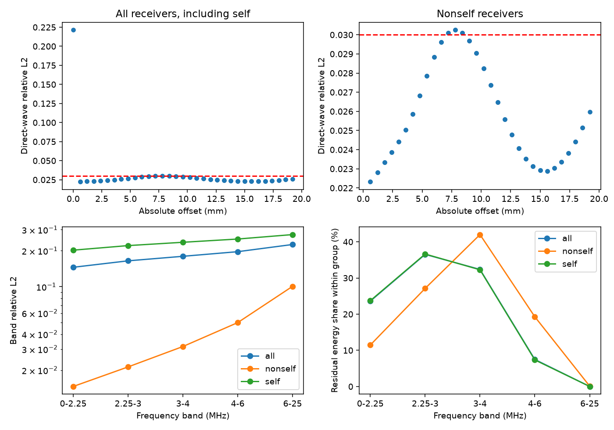

# 几何补偿后的加密门槛与残差分布

2026-10-19。按用户修正公式保持二维点源物理总强度，不重新拟合增益或时移。**全接收直达L2=0.165013，仍未达到<0.03；排除自收为0.024770。按原门槛停止，未执行后续缺陷裁判、时间收敛、PML消融或M2。**

## 修正的物理源约定

Deepwave单网格点加源的等效空间源密度积分约为 f × h²。原粗网格公式及对应总源强为：

    f_c[n] = -2/(c_s h_c) × (r_c[n+1]-r_c[n])/dt_c
    Q_c(t) ≈ f_c(t) h_c² = -2 h_c/c_s × r'(t)

要在细网格保持Q不变，使用用户批准的公式：

    f_f[n] = -2 h_c/(c_s h_f² dt_f) × (r_f[n+1]-r_f[n])

相对于上轮直接代入h_f的公式，再乘 h_c/h_f=2。h_c=0.1 mm，h_f=0.05 mm，dt_f=2.5 ns，源位置c_s=5800 m/s。代码复用前向差分，再乘配置中的几何比例；不是拟合幅度。Deepwave更新中的 -c²dt² 属于时间积分，空间源积分仍按f h²比较。

Ricker保持2.25 MHz、峰延迟3/f0=1.333333 μs，t=0为采集启动。两网格共用原冻结增益0.9907679913977262和0时移（不是把精度截成0.99077）。源的时空绝对值积分细/粗比约1.000228，剩余微小偏差来自时间采样与前向差分。未对输出再缩放或移动。

## 均匀单炮结果

只运行第32炮、64接收、全5800 m/s。800×800、h=0.05 mm、dt=2.5 ns、8000步、accuracy=8、外置40点PML=2 mm，阵元物理坐标与粗网格相同。细网格每8点、粗网格每4点抽取到20 ns、1000点。粗网格复用上轮数组；没有新增缺陷仿真。

门槛和窗口沿用上轮：各接收理论直达峰±0.5 μs，将窗口内样本合并计算全局L2，分母为粗网格范数。下表相关是全局去均值Pearson相关；完整1000点结果同时公开，不更换窗口使其通过。

| 范围 | 相对L2 | 细/粗范数比 | 全局相关 |
|---|---:|---:|---:|
| 全部64接收直达窗 | 0.165013 | 1.116172 | 0.993848 |
| 排除源点自收 | 0.024770 | 1.000273 | 0.999693 |
| 原4.8–14.4 mm直达子集 | 0.027886 | 1.002510 | 0.999615 |
| 全部接收完整20 μs记录 | 0.165009 | 1.116167 | 0.993848 |

传播及回传0.622075秒，含准备0.623343秒，完整进程5.287秒。Torch分配峰值32.12 MiB，整卡轮询峰值1669 MiB（含其他进程，非连续精确峰值）；无OOM、无数值发散、退出码0。只执行一次补偿后的传播，后续分析只读取保存数组。

## 残差的偏移距分布

以同一直达窗统计平方残差能量。自收道占总残差能量的**98.9849%**，同时占粗网格直达信号能量54.9512%。它的单道L2为0.221469，是全局门槛未通过的主要贡献；并非所有传播道都仍有约16.5%的误差。

| 绝对偏移距 | 接收数 | 组内L2 | 占全部直达残差能量 |
|---|---:|---:|---:|
| self | 1 | 0.221469 | 98.9849% |
| (0,3] mm | 10 | 0.022951 | 0.4852% |
| (3,6] mm | 10 | 0.026673 | 0.1889% |
| (6,12] mm | 20 | 0.028920 | 0.2352% |
| (12,20] mm | 23 | 0.023813 | 0.1058% |

非自收的组平均L2均低于0.03，但个别7–9 mm附近道略高于0.03；这不是新的逐道通过条件。偏移距误差不是单调递增，不能只根据传播距离将全部差异归为数值频散。

## 残差的频带分布

对完整1000点记录做FFT，使用完整记录的矩形窗和单边Parseval权重，不拟合、不滤波。这里采用完整时间窗避免各道不同直达窗截断带来的额外频谱影响；这是事后诊断，不替代预先规定的直达门槛。能量份额在各列所属接收组内归一化。

| 频带MHz | 全接收带内L2 | 全接收残差份额 | 非自收带内L2 | 非自收残差份额 |
|---|---:|---:|---:|---:|
| 0–2.25 | 0.145186 | 23.6111% | 0.014641 | 11.4744% |
| 2.25–3 | 0.164393 | 36.5295% | 0.021330 | 27.1299% |
| 3–4 | 0.179365 | 32.3675% | 0.031588 | 42.0019% |
| 4–6 | 0.196059 | 7.4759% | 0.050055 | 19.2781% |
| 6–25 | 0.225125 | 0.0160% | 0.100616 | 0.1156% |

非自收残差中3–6 MHz约占61.28%，高频相对误差更大；但6–25 MHz只占非自收残差约0.116%，该弱能量带较大的相对L2不能被当作主要误差源。全部接收残差约92.51%位于0–4 MHz，反映自收道误差并不局限于Ricker极高频尾部。

## 解释与边界

直接观察支持：几何补偿已恢复非自收传播波幅度，剩余全局误差主要集中在离散点源自身接收。网格加密改变单网格点源的物理支撑面积；即使积分强度相同，源点处离散近场/自响应仍可能随网格变化。**这是首要解释，但未通过独立实验完全分离其贡献。**

非自收高频误差增加与空间/时间离散误差相容；前向差分时间截断及点接收表示也可能贡献。阵列离顶部PML只有0.2 mm，PML算法在两网格下的离散行为仍可能影响结果。当前既没有独立改变dt，也没有移动PML，因此不能把残差定量归因于频散或PML。保持固定源后不继续调参，也不擅自排除对角线放宽门槛。

## 裁判任务状态与固定决策

| 方案 | 全窗散射L2/相关 | 12–20 μs散射L2/相关 | 本轮三炮耗时 |
|---|---|---|---|
| Deepwave粗网格 | 未评估 | 未评估 | 未执行，已有数据保留 |
| k-Wave dt=5 ns | 未评估 | 未评估 | 未执行，已有数据保留 |
| k-Wave dt=2.5 ns | 未评估 | 未评估 | 未执行 |
| k-Wave dt=1.25 ns | 未评估 | 未评估 | 未执行 |
| Deepwave顶部PML距离变体 | 未评估 | 未评估 | 未执行 |
| k-Wave顶部PML距离变体 | 未评估 | 未评估 | 未执行 |

上述散射指标需要缺陷减均匀，不能用本次均匀直达结果替代。尚未生成有效缺陷裁判，0.15阈值、训练求解器推荐和300/500样本细网格预算均未触发。没有证据判定两个粗网格求解器谁更准，也不能声称“两者都不收敛”。按用户未通过即停的分支完成本轮残差诊断，不执行M2。

## 复现与审计

- [配置](../configs/refinement_compensated.json)、[门槛测量](../configs/refinement_compensated_measurements.json)、[逐道/频带测量](../configs/refinement_residual_measurements.json)。
- 运行：`& .\code\run_refinement_gate.ps1 -ConfigPath E:\FNO_research\repos\fno_light\repro_lu2026\configs\refinement_compensated.json`。启动器设置E盘缓存/临时目录，创建唯一输出目录，不自动安装。
- 分析：[analyze_refinement_residual.py](../code/analyze_refinement_residual.py)接受配置路径和结果目录两个参数，仅读保存数据、不传播。输出文件若存在会被重分析覆盖，应使用新的输出目录副本。
- 本次目录：`E:/FNO_research/results/refinement_gate_20261019_190257_903/`。大数组和日志不入库。
- 已检查粗输入SHA256、细粗Ricker采样一致性、输出形状、有限值、FFT Parseval恒等式、全部分组覆盖、JSON/脚本语法以及两张PNG。未增加任何拟合。
- [上一轮未补偿报告](refinement_gate_report.md)保留作为历史记录；本轮替换物理源公式，不改旧数据或旧报告。
