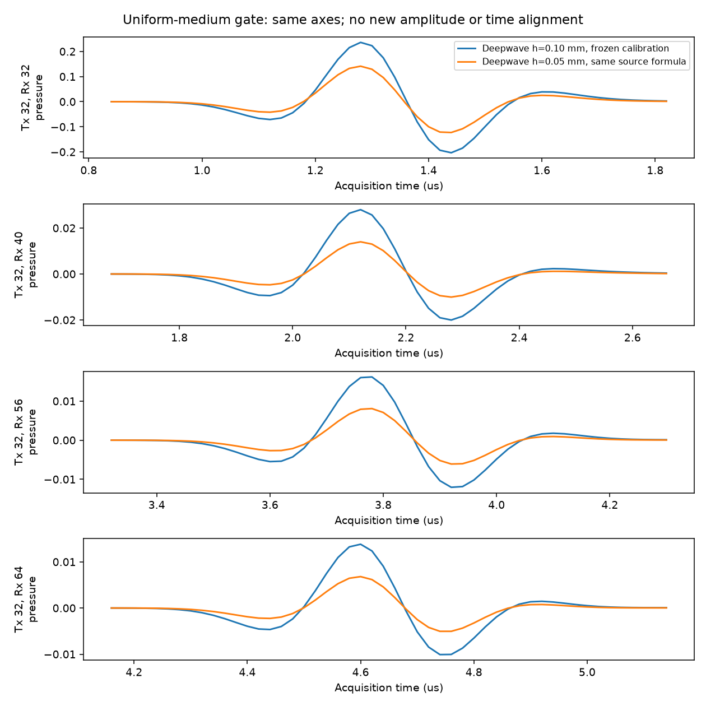

# 加密裁判前置检查：源的网格归一化不一致

2026-10-19。结论：均匀单炮门槛失败，尚未得到可用于裁决的散射参考解。没有重拟合、没有修改冻结源公式，没有开始M2或安装软件。

## 执行与结果

按[预注册协议](refinement_protocol.md)，只新增第32炮、全64接收的均匀5800 m/s仿真：800×800、h=0.05 mm、dt=2.5 ns、8000步、accuracy=8、四边40点PML（2 mm）。阵元物理坐标保持不变。原200标签重复4×4的构造已检查，但没有传播缺陷模型。粗网格均匀结果复用上轮保存数组。

前向差分输入使用新h和dt；冻结增益0.9907679913977262、时移0。细网格每8点抽取到20 ns、1000点，粗网格每4点抽取；没有新幅度或时间对齐。直达窗是各接收理论峰值时间±0.5 μs。相对L2分母为粗网格结果范数；相关为同时刻、去均值的Pearson相关。

| 均匀波比较范围 | 相对L2 | 细/粗范数比 | 全局相关 | 逐道相关均值 |
|---|---:|---:|---:|---:|
| 全64接收直达窗（预定门槛） | 0.449616 | 0.558086 | 0.993848 | 0.999631 |
| 排除发射点自身接收，63道 | 0.500170 | 0.500137 | 0.999693 | 0.999678 |
| 上轮4.8–14.4 mm直达接收子集 | 0.499131 | 0.501255 | 0.999615 | 0.999629 |
| 全64接收、完整1000点 | 0.449619 | 0.558083 | 0.993848 | 0.999631 |

预设要求相对L2严格小于0.03，实测未通过。相关很高不能替代幅度误差门槛。源点自收的近场对全局范数有较大影响，所以同时公开排除源点和远距子集；三种直达范围均不通过。

传播及回传0.595721秒，含准备0.597186秒；含导入、分析、保存与绘图的进程耗时5.379秒。Torch分配峰值32.12 MiB，保留峰值42 MiB；整卡轮询观测峰值1670 MiB（含其他GPU进程，轮询可能漏过瞬时峰值）。实际只算1炮，配置中的batch=3是上限；无OOM、无数值异常，退出码0。

## 源强为什么约减半

冻结的二维单网格点输入为

    f_h[n] = -2/(c_s h) × (r[n+1] - r[n])/dt

Deepwave通过 -c²dt² f_h 注入二阶更新。这里dt²是时间积分系数，不能当作连续源强的额外时间缩放。对空间源密度积分，单网格点的面积权重为h²：

    Q_h(t) ≈ h² f_h(t) = -2h/c_s × r'(t)

因此，保持Ricker及冻结增益，只将h减半，二维总源强也约减半。此公式来自原网格上的k-Wave源匹配；跨网格时仅代入新h不保证相同物理点源。时间前向差分的截断误差仍存在，故比值不是逐点精确0.5。

独立的离散源审计计算 sum(abs(f_h)) × dt × h²：细网格为6.5253871e-8，粗网格为1.3047802e-7，比值约0.500114。这里使用绝对值积分，因为导数子波的有符号积分接近零。该源强比与非自收直达波范数比0.500137一致，支持幅度偏差主要来自网格源归一化，而不是传播频散。源点自收还受离散近场表示影响，不能直接用它解释远场源强。

这是推导与一次预定实验共同支持的诊断，不是新增幅度拟合。没有进行乘2后的传播或指标计算，也不能据此宣称修正后必然通过0.03。

## 请求的裁判表与停止位置

下表中的“未评估”不是零误差或求解失败。前置门槛没有通过，不能拿不同源强的细网格结果作散射裁判；已有粗网格数据也没有据此比较。

| 方案 | 全窗散射L2/相关 | 12–20 μs散射L2/相关 | 本轮三炮耗时 |
|---|---|---|---|
| Deepwave粗网格 | 未评估 | 未评估 | 未执行，已有数据保留 |
| k-Wave dt=5 ns | 未评估 | 未评估 | 未执行，已有数据保留 |
| k-Wave dt=2.5 ns | 未评估 | 未评估 | 未执行 |
| k-Wave dt=1.25 ns | 未评估 | 未评估 | 未执行 |
| Deepwave顶部PML距离变体 | 未评估 | 未评估 | 未执行 |
| k-Wave顶部PML距离变体 | 未评估 | 未评估 | 未执行 |

用户规定的0.15阈值及求解器选择规则保持不变，当前均未触发；不能推断“两者都不收敛”，也不能判断谁的散射场更准。单个均匀炮计时不足以给出经过验证的64炮缺陷模型批处理速度，本轮不据此报300/500样本预算。

继续之前需要明确跨网格的物理点源归一化。例如以原0.1 mm点源总强度为基准，新网格源在原公式外乘h_coarse/h_fine=2，是网格几何推导得到的补偿，而非数据拟合；但这超出本轮“仅代入新h、dt”的冻结公式，故没有自行执行。还需重新验证均匀门槛，不能直接跳过它。当前问题已明确，不重复运行同一配置，也没有用两次尝试额度反复调参。

## 复核与复现

- [执行配置](../configs/refinement_gate.json)、[原始测量](../configs/refinement_gate_measurements.json)、[检查代码](../code/refinement_gate.py)、[E盘启动脚本](../code/run_refinement_gate.ps1)。脚本仅运行前置检查，无后续自动传播。
- 从项目子目录运行：`& .\code\run_refinement_gate.ps1 -ConfigPath E:\FNO_research\repos\fno_light\repro_lu2026\configs\refinement_gate.json`。依赖已有E盘环境与上轮结果，不安装软件；每次创建唯一结果目录。
- 本次数据与日志位于E盘，数据不入库：`E:/FNO_research/results/refinement_gate_20261019_185615_866/`，日志`E:/FNO_research/logs/refinement_gate_20261019_185615_866.log`。
- 输入粗网格HDF5的SHA256在执行配置中固定并校验；同一解析Ricker细网格每2点与旧采样一致性检查通过。图已人工查看，未对绘图波形单独归一化。
