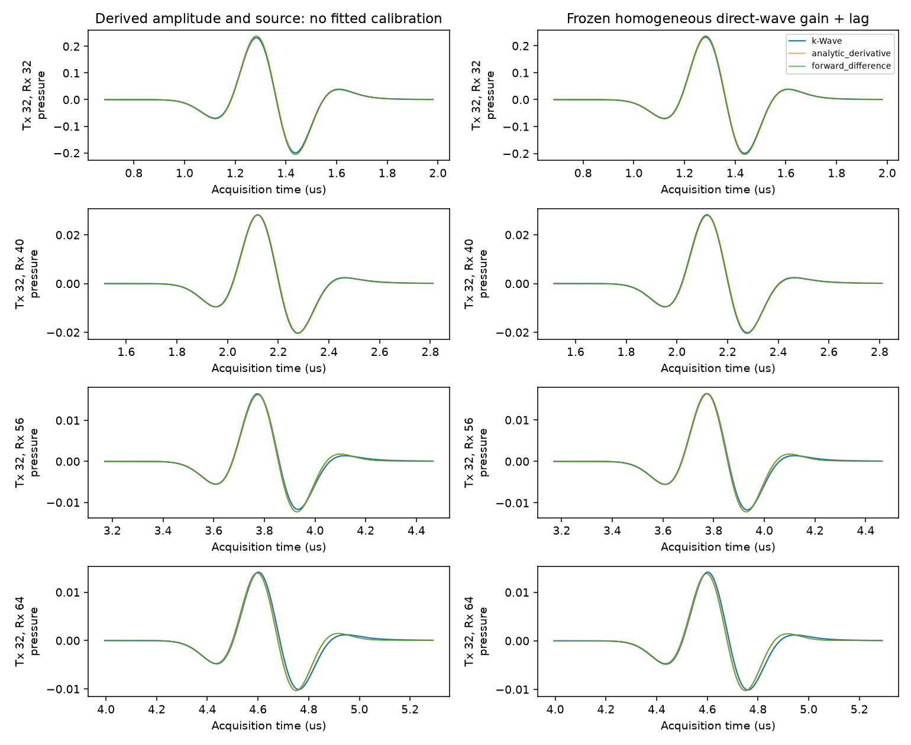
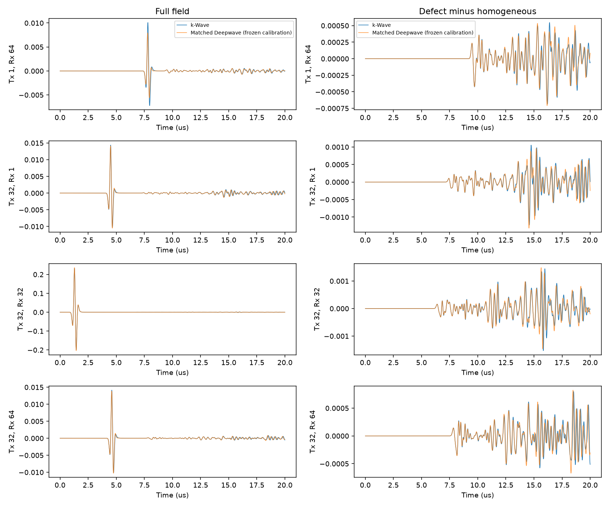
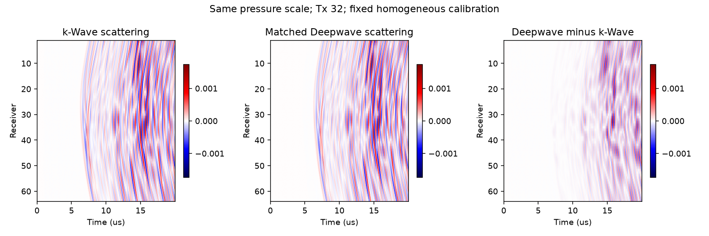
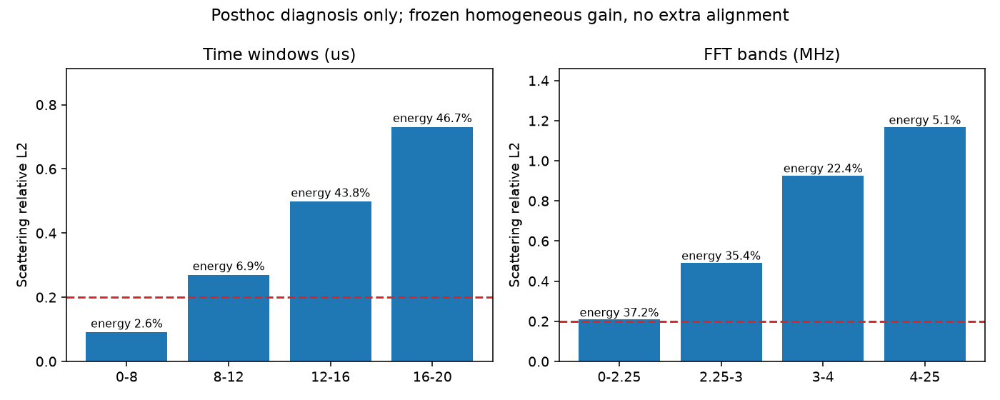

# 源匹配诊断：直达波已基本匹配，散射判据未通过

2026-10-19。**本轮不把Deepwave定为训练集求解器，也不据此把k-Wave定为绝对真值。** 源导数修正有推导和均匀介质实验支持，但预注册主方案的整体平均相关系数0.98807虽超过0.95，散射相对L2仍为0.60276，未达到0.2。没有开始M2，没有安装任何软件。

旧12文件已提交并推送：`21e82e4`；第一次连接超时，第二次成功。本轮诊断按新的授权，在核对清单及单次小于5MB后自行推送代码、配置、报告和PNG；大数据不入库。

## 1. 源方程与离散时序

实际核对了本机k-Wave1.4.1的`kspaceFirstOrder_scaleSourceTerms.m`、`kspaceFirstOrder2D.m`，以及Deepwave0.0.27的`scalar.py`和`regular_grid.py`。以下推导不依赖事后拟合散射结果。

设k-Wave原始压力输入为r(t)，N=2，源处声速c_s=5800m/s，网格h=0.1mm，时间步Δt=5ns。k-Wave additive模式把输入按

$$s_\rho[n]=\frac{2\Delta t}{N c_s h}r[n]$$

缩放后，加入N个分裂密度分量；压力由$p=c^2\sum_i\rho_i$重建。忽略空间源滤波时，每步压力源增量为

$$B r[n],\qquad B=\frac{2c_s\Delta t}{h}=0.58.$$

常密度一阶系统可写成

$$\partial_t\mathbf u=-\frac{1}{\rho_0}\nabla p,\qquad
\partial_t p=-\rho_0c^2\nabla\cdot\mathbf u+\frac{2c_s}{h}r(t)\delta_h.$$

消去速度：

$$\partial_{tt}p-c^2\nabla^2p=\frac{2c_s}{h}r'(t)\delta_h.$$

Deepwave源码在输入到二阶更新前实际乘的是**−c_s²Δt²**，因此同一物理压力源对应的连续候选为

$$f_D(t)=-\frac{2}{c_s h}r'(t).$$

这里负号来自Deepwave的forcing符号约定，不是事后翻转波形以提高相关性。常密度ρ₀在消元时抵消；不能再随意补乘1000。

进一步考虑记录次序：k-Wave第n点在注入r[n]、重建压力后记录；Deepwave先记录u[n]，再用f_D[n]更新u[n+1]。由一阶离散式消去速度，二阶源项为B(r[n]−r[n−1])。所以预先选定的主方案为

$$\boxed{f_D[n]=-\frac{2}{c_s h\Delta t}\big(r[n+1]-r[n]\big)}.$$

系数为−6.896551724×10⁸，作用于相邻Ricker数值之差。末尾使用零延拓；本次首尾Ricker近零，初始条件差异极小。另一预定对照是解析导数：令$a=\pi f_0(t-t_0)$，则$r'=\pi f_0(4a^3-6a)e^{-a^2}$。导数和差分计算用float64，再转float32传播。

这并不是“两种离散求解器严格等价”的证明：k-Wave还对源施加空间$\cos(c_{ref}|k|\Delta t/2)$滤波，传播使用k-space修正；Deepwave为8阶空间差分、二阶时间推进。这些区别保留在诊断里，没有把k-Wave的空间源滤波偷偷添加到Deepwave。

## 2. 均匀介质单炮验证与冻结校准

完整400×400域全部5800m/s，第32阵元发射、64阵元接收。两边仍用5ns×4000步，原始采集t=0定义不变。表中“未标定”指使用推导子波及其理论常数后，没有再拟合幅度/时移；相对L2为全64道1000点的全局范数比，相关为逐道零lag Pearson均值。

| 输入到Deepwave的子波 | 未标定相对L2 | 未标定相关均值 | 均匀直达波标定后相对L2 |
|---|---:|---:|---:|
| 原Ricker | 1.000000 | 0.001307 | 0.951936（仅作为失败对照） |
| 理论系数×解析导数 | 0.042164 | 0.998549 | 0.039169 |
| 理论系数×前向差分，主方案 | **0.034958** | **0.997850** | **0.031582** |

源修正前后变化很大，因此“源方程存在时间导数和常数缩放差异”得到了实验支持；不是仅凭怀疑宣布结论。

只使用均匀单炮、距发射4.8–14.4mm接收道、理论直达峰±0.5μs窗口标定，排除自收自发近场。额外时间平移仅搜索±4个内部采样点（±20ns）。前向差分得到**幅度0.9907679914、额外时移0ns**；解析导数得到0.9902749677、0ns。随后冻结，所有64炮、两种介质和相减后的散射共用同一组参数。

原Ricker失败对照的最优lag落在20ns搜索边缘，表明它不能靠这点小的时序校准解决；本次没有扩大窗口继续拟合。它与上轮在缺陷真值上搜索±500ns所得0.542误差是不同的标定实验，不能混为一谈。

左右列使用真实压力数值，分别为推导后未标定与冻结标定；没有每道归一化。均匀第32炮在单炮与64炮批处理中的结果逐元素一致，三个子波版本相对差均为0。

## 3. 完整64炮、缺陷场及散射

保持与旧参考相同的声速数组、网格和点阵列。k-Wave使用伪谱法，并不存在“同为8阶”的说法；Deepwave明确accuracy=8。两边均为**四边外置20点PML、无自由面/底面反射**。物理边界意图和厚度一致，但k-Wave的split-field PML（alpha=2）与Deepwave PML（pml_freq=2.25MHz）算法不同，不能声称逐项相同。

散射严格计算为同求解器的$F_{defect}-F_{homogeneous}$，即缺陷诱导响应，包括多次散射和与吸收边界的相互作用，不是假设Born近似的单次散射。完整20μs时间窗、全部4096道参与指标；没有为了过阈值截去晚期部分。

### 每步未标定结果

每格为“全局相对L2 / 逐道零lag相关均值”。每4点抽取到1000点，未作额外增益或平移。

| 子波 | 均匀64炮 | 缺陷64炮 | 缺陷减均匀的散射 |
|---|---:|---:|---:|
| 原Ricker | 1.000000 / −0.030156 | 1.000000 / −0.034857 | 1.000000 / −0.288459 |
| 理论解析导数 | 0.051459 / 0.993918 | 0.063611 / 0.990827 | **0.572683 / 0.839886** |
| 理论前向差分 | 0.048356 / 0.991458 | 0.062488 / 0.988068 | **0.605594 / 0.820857** |

### 冻结均匀校准后的结果

| 子波 | 均匀相对L2 | 缺陷相对L2 | 缺陷相关均值 / 中位数 | 散射相对L2 | 散射相关均值 |
|---|---:|---:|---:|---:|---:|
| 原Ricker失败对照 | 0.952450 | 0.952940 | 0.246950 / 0.278497 | 1.060389 | −0.043896 |
| 解析导数 | 0.049251 | 0.061734 | 0.990827 / 0.995339 | **0.569858** | 0.839886 |
| 前向差分，预定主方案 | 0.046169 | **0.060697** | **0.988068 / 0.994720** | **0.602761** | **0.820857** |

主方案缺陷全局加权相关为0.998181；逐道相关最小0.932832，不能称每一道都超过0.95。排除自收自发后，散射相对L2仍为0.602862，失败不是由对角线独占指标引起。主方案互易相对L2为2.719e-6。

**判据结论：整体相关>0.95通过；散射L2<0.2未通过。两种预定源修正都没有满足散射判据，所以本轮停止修正，不确定训练集求解器。** 没有利用较好的某几道或早期窗口替换预定全窗判据。

参考散射的范数只有完整场的**6.56%**，平方范数比只有**0.430%**。因此，完整FMC看起来高度一致、L2约6%，完全可能同时存在60%的散射相对误差；直达波会掩盖训练所需散射信息的差异。

## 4. 剩余差异：已有证据与归因边界

以下是已有数组上的事后诊断，没有新增正演、调整标定或改变判据。

| 散射时间段 | 参考散射能量占比 | 相对L2 |
|---|---:|---:|
| 0–8μs | 2.59% | 0.0906 |
| 8–12μs | 6.91% | 0.2693 |
| 12–16μs | 43.77% | 0.4980 |
| 16–20μs | 46.73% | 0.7307 |

| 矩形记录FFT频带 | 参考散射能量占比 | 频带相对L2 |
|---|---:|---:|
| 0–2.25MHz | 37.17% | 0.2091 |
| 2.25–3MHz | 35.40% | 0.4917 |
| 3–4MHz | 22.36% | 0.9271 |
| 4–25MHz | 5.08% | 1.1685 |

晚期、高频误差更大，与累计相位误差相容；**这不是独立证明只有频散造成误差**。截短时间或低通都能改变评分，但本次没有用它们通过判据。

### 数值频散：不能把k-Wave视作无误差参考

对无限均匀网格，8阶中心差分D₂系数为−205/72、8/5、−1/5、8/315、−1/560，配合二阶时间推进可直接计算离散色散关系。另一方面，当前k-Wave参考固定$c_{ref}=5800$，其局部均匀模型符号满足

$$\sin(\omega_{num}\Delta t/2)=\frac{c}{c_{ref}}\sin(c_{ref}|k|\Delta t/2).$$

当局部c=c_ref时此式在本频带无相位误差；**低声速区域c=1500≠c_ref时不再如此**。下面只是局部均匀近似，不是异质模型的收敛测试：

| 1500m/s区域频率 | 每波长网格点 | Deepwave轴向相速度误差 | k-Wave固定c_ref近似误差 |
|---|---:|---:|---:|
| 2.25MHz | 6.67 | +0.0127% | −0.2903% |
| 3MHz | 5.00 | −0.0320% | −0.5160% |
| 4MHz | 3.75 | −0.4589% | −0.9169% |
| 6MHz | 2.50 | −6.2171% | −2.0597% |

8阶差分还具有方向性：6MHz、45°方向的相速度误差约−0.6312%。不能仅按“至少2点/波长”保证两者同精度。3MHz时两种近似相速度相差约0.484%；若波在该介质停留10μs，对应累计相位差可约0.91rad。这是说明量级的假想路径，不是对本模型射线路径的测量。

大于6MHz的参考散射能量仅约0.119%，不能把全部60%误差归咎于6MHz尾部。3–4MHz频带占22.4%能量且误差明显，较小的速度误差在晚期多次传播中累积是值得优先检验的原因。

### PML、空间源及网格表示

- **网格数组核查通过**：两边使用同一400×400数组，且与200×200标签逐像素重复2×2一致；没有发现转置、补零、重插值或缺陷几何不一致。相同数组并不保证伪谱与局部差分在高对比界面上的离散响应相同。
- **PML仍是候选因素**：源和接收距上边界只有2个网格点，远偏移道近于掠射。均匀64炮中少数道相对误差可达约39%，即使均匀全局误差仅4.6%；这提示边界/掠射或空间源处理不能忽视。没有扩大PML或移动边界做消融，所以不能定量归因。
- **k-space空间源滤波未复制**：时间导数已解决主导源类型差异，但cos空间滤波、近场与离散源点响应仍不同。均匀标定约1%的增益不能替代完整频率/方向响应。

合理的后续诊断优先级是固定同一模型做时间步收敛（包含k-Wave低速区c_ref影响）、空间步长收敛，再做PML/边界距离消融。**本轮未执行这些额外实验**，也没有为过阈值继续试第三种子波。

## 5. 成本、复查与复现

k-Wave均匀第32炮计算8.306秒、进程28.353秒；其余63炮计算256.121秒、进程268.576秒。合计均匀参考计算264.427秒。已有缺陷k-Wave和原Ricker Deepwave数据复用，没有重新生成。

Deepwave前向差分均匀64炮传播及回传1.979秒，缺陷64炮1.966秒；各为一次64炮，未发生OOM，torch峰值分配约465.94MiB，整卡采样峰值约2068MiB。包含原Ricker均匀、两种修正的两介质传播，以及分析保存绘图的完整Python进程19.689秒。这是诊断成本，不是单个训练样本成本。所有数组有限；不含训练和M2调度。

大数据保存在本机：

- `E:/FNO_research/results/source_match_uniform_single_20261019_173712_226`
- `E:/FNO_research/results/source_match_uniform_remaining_20261019_173955_937`
- `E:/FNO_research/results/source_match_single_20261019_173928_349`
- `E:/FNO_research/results/source_match_full_20261019_174522_792`

完整源匹配HDF5为524,344,192字节，SHA256为`e0dd0a63e4d0eafe7e3e9a4a43374dd5b8a6d270a0c6bcf8256a3199828192ef`，保存三种子波的均匀/缺陷4000点数据和参考散射。标定JSON冻结且与单炮完全相同；k-Wave相减数组逐元素核对通过。完整数值见[测量记录](../configs/source_match_measurements.json)。四张关键PNG已打开核对，均小于1MB，图片使用仓库相对路径。

复现入口：`code/run_source_match.ps1 -ConfigPath <source_match_single.json绝对路径> -Stage single`，确认单炮后用`source_match_full.json -Stage full`。配置指定既有均匀MAT和冻结校准路径；重新运行应使用新目录并先生成对应参考。`code/analyze_source_match.py configs/source_match_audit.json`只分析已有数据，不再传播；调用时沿用项目E盘环境变量，避免默认缓存路径。

最终状态：源类型假说得到验证；完整相关判据通过；散射判据未通过；停止诊断，不开始M2，不确定最终训练集求解器。
